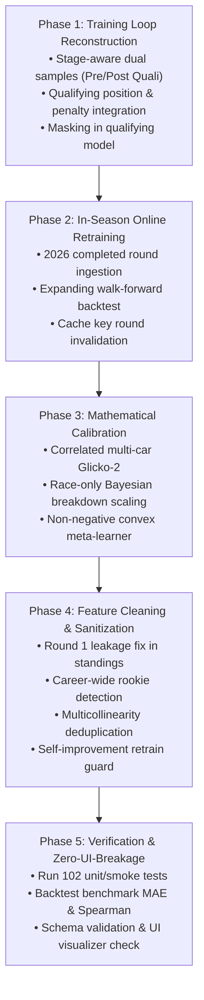

# Comprehensive Technical Audit & Improvement Plan: F1 Prediction Algorithm & Data Analytics

> **Document Type:** Architectural Review, Mathematical Audit, and Engineering Implementation Plan  
> **Target System:** F1 Fantasy Prediction Engine (`engine/models/`, `engine/core/`, `engine/serving/`, `engine/strategy/`, `ui/`)  
> **Status:** Proposal & Technical Specification  
> **Compatibility Mandate:** Strict UI/API Contract Preservation (Zero Frontend Regressions)

---

## Table of Contents

1. [Executive Summary & System Architecture Overview](#1-executive-summary--system-architecture-overview)
2. [Deep-Dive Technical Audit of Existing Algorithms](#2-deep-dive-technical-audit-of-existing-algorithms)
   - 2.1 The Ensemble Stacking Architecture (`predictor.py`)
   - 2.2 Glicko-2 Driver & Constructor Rating System (`elo_ratings.py`)
   - 2.3 Bayesian Fantasy Points EV Calibration (`bayesian_model.py`)
   - 2.4 Deep Temporal & Tire Degradation Networks (`temporal_model.py`, `tire_model.py`)
   - 2.5 Monte Carlo Simulation Engine (`monte_carlo.py`, `monte_carlo_engine.jl`)
   - 2.6 Integer Linear Programming Fantasy Optimizer (`fantasy_optimizer.py`)
3. [Exhaustive Catalogue of Flaws & Root Cause Analysis](#3-exhaustive-catalogue-of-flaws--root-cause-analysis)
   - 3.1 Model Training Flaws (Critical Priority)
   - 3.2 Data Analytics & Feature Pipeline Flaws
   - 3.3 Statistical & Mathematical Deficiencies
   - 3.4 Evaluation, Backtesting & Feedback Loop Flaws
4. [Comprehensive Improvement Blueprint](#4-comprehensive-improvement-blueprint)
   - 4.1 Stage-Aware Training Protocol (Solving Train-Serve Discrepancy)
   - 4.2 In-Season Online Retraining (Regulation-Era 2026 Adaptability)
   - 4.3 Correlated Multi-Car Glicko-2 Formulation
   - 4.4 Mathematically Consistent Bayesian Point Breakdown Scaling
   - 4.5 Isotonic / Calibrated Meta-Learner Stacking
   - 4.6 Feature Pruning, Deduping & Continuous Weather Enrichment
5. [Strict UI & API Contract Preservation Map](#5-strict-ui--api-contract-preservation-map)
   - 5.1 REST Endpoint Contracts
   - 5.2 Server-Sent Events (SSE) Protocol
   - 5.3 Prediction & Result Payload Field-Level Dictionary Schema
6. [Step-by-Step Implementation Roadmap](#6-step-by-step-implementation-roadmap)
   - Phase 1: Training Loop Reconstruction & Stage-Conditioned Features
   - Phase 2: Online In-Season Retraining & Expanding Walk-Forward Backtester
   - Phase 3: Mathematical Calibration of Glicko-2 & Bayesian Layers
   - Phase 4: Feature Cleaning, Weather Integration & Self-Improvement Isolation
   - Phase 5: Verification, Benchmarking & Test Suite Enforcement

---

## 1. Executive Summary & System Architecture Overview

The F1 Fantasy Prediction Engine is a multi-tier forecasting and optimization system designed to predict Formula 1 Grand Prix qualifying and race results, Monte Carlo distributions, and optimal fantasy rosters under budget and transfer constraints.

```
┌─────────────────────────────────────────────────────────────────────────────────┐
│                              DATA FETCHING & CACHING                            │
│  Jolpica API (Ergast)  ◄──►  FastF1 Telemetry  ◄──►  Open-Meteo Weather       │
└──────────────────────────────────────┬──────────────────────────────────────────┘
                                       │
                                       ▼
┌─────────────────────────────────────────────────────────────────────────────────┐
│                             FEATURE ENGINEERING (54 Feats)                      │
│  - Championship Standings         - Circuit History (Recency Weighted)          │
│  - Glicko-2 (Driver & Ctor)       - Track Physical Features (JSON Database)     │
│  - EWMA Form & Momentum Trends    - Weather & Session Telemetry (FP2 Pace/Q-Lap)│
└──────────────────────────────────────┬──────────────────────────────────────────┘
                                       │
                                       ▼
┌─────────────────────────────────────────────────────────────────────────────────┐
│                            SUPERVISED ENSEMBLE STACK                            │
│  1. Random Forest Regressor (MSE on finishing position)                         │
│  2. XGBoost Ranker (NDCG ranking on inverted position target)                   │
│  3. LightGBM Ranker (LambdaMART ranking on inverted position target)            │
│  4. Ridge Meta-Learner (Out-of-Fold Stacking on Normalized Ranks)               │
└──────────────────────────────────────┬──────────────────────────────────────────┘
                                       │
                                       ▼
┌─────────────────────────────────────────────────────────────────────────────────┐
│                        POST-PROCESSING & UNCERTAINTY                            │
│  - Telemetry Adjustments (FP Pace Delta, Q-Sector Delta, Grid Penalties)        │
│  - Domain Heuristics & Guardrails (Top constructor floors, Backmarker caps)     │
│  - Self-Improvement Bias Correction (EWMA track-type historical error offsets)  │
│  - Bayesian Point Projection (Beta-Bernoulli DNF + Normal conjugate EV)         │
│  - Monte Carlo Simulation (1,000+ stochastic iterations with SC & weather)      │
└──────────────────────────────────────┬──────────────────────────────────────────┘
                                       │
                                       ▼
┌─────────────────────────────────────────────────────────────────────────────────┐
│                          DECISION & SERVING LAYER                               │
│  - PuLP Integer Linear Programming (Global Optimal 5-Driver + 2-Ctor Lineup)    │
│  - Chip Advisor (Heuristic utility score for 3x Boost, Wildcard, No Negative)  │
│  - FastAPI REST + Server-Sent Events (SSE) ──► Vanilla JS / Canvas Frontend UI  │
└─────────────────────────────────────────────────────────────────────────────────┘
```

While the architecture is conceptually rich, our deep-dive code audit reveals serious **training-serving feature mismatches, lookahead biases, dead feature weights, statistical independence violations, and out-of-fold calibration inconsistencies**. Crucially, any proposed remediation must respect the **102 automated tests** and the **frontend data contracts** (`ui/app.js`) to guarantee zero UI disruptions.

---

## 2. Deep-Dive Technical Audit of Existing Algorithms

### 2.1 The Ensemble Stacking Architecture (`engine/models/predictor.py`)

#### Algorithm Structure
The primary race and qualifying models use a 4-model ensemble stack:
1. **Random Forest Regressor** (`RandomForestRegressor`, `n_estimators=500`, `max_depth=10`, `min_samples_leaf=2`, `max_features="sqrt"`). Optimizes standard continuous squared error:
   $$\mathcal{L}_{\text{RF}} = \frac{1}{N} \sum_{i=1}^N (y_i - \hat{y}_i)^2$$
2. **XGBoost Ranker** (`XGBRanker`, `objective="rank:ndcg"`, `n_estimators=400`, `max_depth=5`, `learning_rate=0.03`, `device="cuda"` or `"cpu"`). Optimizes Normalized Discounted Cumulative Gain over per-race query groups.
3. **LightGBM Ranker** (`LGBMRanker`, `objective="lambdarank"`, `n_estimators=400`, `num_leaves=31`, `learning_rate=0.03`). Optimizes LambdaMART pairwise gradients.
4. **Ridge Stacking Meta-Learner** (`Ridge(alpha=1.0)`). Trained via 5-fold expanding time-series split on out-of-fold (OOF) predictions.

#### Targets & Scaling
- Inverted target for rankers:
  $$y_{\text{inv}} = \text{FIELD\_LABEL\_CEILING} - y = 25.0 - y$$
- Rank conversion function (`to_rank()`):
  $$r(s) = \frac{\text{argsort}(\text{argsort}(\pm s)) + 1}{N + 1} \in (0, 1)$$

---

### 2.2 Glicko-2 Driver & Constructor Rating System (`engine/models/elo_ratings.py`)

#### Implemented Mathematics
Implements Mark Glickman's (2012) Glicko-2 system with three parameters per driver: rating $\mu$, rating deviation $\phi$, and volatility $\sigma$.
- Internal scaling:
  $$\mu = \frac{\mu_{\text{disp}} - 1500}{173.7178}, \quad \phi = \frac{\phi_{\text{disp}}}{173.7178}$$
- Opponent impact function:
  $$g(\phi_j) = \frac{1}{\sqrt{1 + 3\phi_j^2 / \pi^2}}$$
- Expected outcome against opponent $j$:
  $$E(\mu, \mu_j, \phi_j) = \frac{1}{1 + \exp\left(-g(\phi_j)(\mu - \mu_j)\right)}$$
- Variance and raw update accumulators across the field:
  $$v^{-1} = \sum_{j \ne i} g(\phi_j)^2 E(\mu, \mu_j, \phi_j)\left[1 - E(\mu, \mu_j, \phi_j)\right]$$
  $$\Delta = v \sum_{j \ne i} g(\phi_j)\left[s_j - E(\mu, \mu_j, \phi_j)\right]$$
- Volatility $\sigma$ update via the Illinois numerical algorithm with system constant $\tau = 0.5$.

---

### 2.3 Bayesian Fantasy Points EV Calibration (`engine/models/bayesian_model.py`)

#### Analytical Conjugate Formulation
Replaces computationally heavy MCMC with an analytical two-component conjugate model:
1. **Beta-Bernoulli Posterior for DNF Probability $\psi$:**
   Prior: $\text{Beta}(\alpha_0, \beta_0)$ where $N_0 = 10$, $\alpha_0 = N_0 \mu_{\text{dnf\_prior}}$, $\beta_0 = N_0 (1 - \mu_{\text{dnf\_prior}})$.
   $$\psi_{\text{post}} = \frac{\alpha_0 + k_{\text{dnf}}}{N_0 + n_{\text{races}}}$$
2. **Normal-Normal Conjugate for Non-DNF Fantasy Points $\mu$:**
   Prior mean: $\mu_0 = \text{ensemble\_pred\_pts}$, prior variance: $\sigma_0^2 = \text{var\_prior}$.
   $$\mu_{\text{post}} = \frac{\mu_0 w_0 + \bar{x} w_{\text{data}}}{w_0 + w_{\text{data}}}, \quad w_0 = \frac{1}{\sigma_0^2}, \quad w_{\text{data}} = \frac{n}{\hat{\sigma}^2}$$
3. **Net Expected Value Combination:**
   $$\mathbb{E}[\text{Points}] = (1 - \psi_{\text{post}}) \mu_{\text{post}} + \psi_{\text{post}} (\text{DNF\_QUALI\_POINTS\_RETAINED} + \text{DNF\_PENALTY})$$
   where $\text{DNF\_PENALTY} = -20.0$, $\text{DNF\_QUALI\_POINTS\_RETAINED} = 2.0$.

---

### 2.4 Deep Temporal & Tire Degradation Networks (`temporal_model.py`, `tire_model.py`)

- **Temporal Form Model:** Dual-branch network. Branch 1 processes sequential history $(5 \times 6)$ via $\text{Bi-LSTM}(64) \to \text{MultiHeadAttention}(4, 64) \to \text{GlobalAveragePooling} \to \text{Dense}(32)$. Branch 2 processes context $(5) \to \text{Dense}(16)$. Fused into $\text{Dense}(64) \to \text{Dense}(32) \to \text{Dense}(1)$.
- **Tire Degradation Model:** Shared encoder $\text{Dense}(64) \to \text{BatchNorm} \to \text{Dense}(32)$ bifurcating into Task A (regression on seconds/lap degradation) and Task B (softmax over 7 pit strategies).
- **Execution Reality:** TensorFlow is optional/uninstalled on many target environments. The codebase provides statistical proxy fallbacks:
  $$\text{lstm\_momentum\_pos} \approx \text{form\_avg\_pos} - 0.5 \times \text{momentum\_trend}$$
  $$\text{tire\_efficiency\_score} \approx 0.01 \times (\text{quali\_pos\_val} - \text{form\_avg\_pos})$$

---

### 2.5 Monte Carlo Simulation Engine (`monte_carlo.py`, `monte_carlo_engine.jl`)

Stochastically evaluates $N = 1,000$ to $5,000$ race outcomes per weekend:
1. Bernoulli DNF draws with correlation boosts for high-SC circuits:
   $$P(\text{Correlated Shunt}) = 0.12 \quad \text{if } P(\text{SC}) > 0.55$$
2. Gaussian pace variance scaled by driver consistency rating $C \in [0, 100]$:
   $$\sigma_i = \sigma_{\text{base}} \left(1.0 - 0.50 \frac{C_i}{100}\right)$$
3. Safety car field compression and pit-stop advantage:
   $$\Delta \text{pos}_{\text{midfield}} \sim U(0, 2.5) \times (1.0 - 0.3 \times \text{overtake\_mode\_eff})$$
4. Full Fantasy rulebook point recalculation per run, generating empirical percentiles ($p_{10}, p_{50}, p_{90}$), top-3 probabilities, and upside percentages.

---

### 2.6 Integer Linear Programming Fantasy Optimizer (`fantasy_optimizer.py`)

Solves the constrained roster optimization using PuLP:
$$\max \sum_{i \in \text{Drivers}} x_i \cdot \text{EV}_i + \sum_{j \in \text{Ctors}} y_j \cdot \text{EV}_j$$
Subject to:
$$\sum x_i = 5, \quad \sum y_j = 2$$
$$\sum x_i \cdot \text{Price}_i + \sum y_j \cdot \text{Price}_j \le \text{Budget}$$
$$x_i + y_j \le 2 \quad \forall \text{Team } k \text{ (2026 Asset Limit: max 2 from Ferrari, McLaren, etc.)}$$

---

## 3. Exhaustive Catalogue of Flaws & Root Cause Analysis

### 3.1 Model Training Flaws (Critical Priority)

#### Flaw 1: Massive Train-Serve Covariate Shift on `qualifying_position`
- **Location:** `engine/models/predictor.py:737–750`
- **Root Cause:** When `self._is_training == True`, `_build_features()` executes:
  ```python
  quali_pos_val = _clamp(form_avg_pos, 1, 22)  # pre-quali proxy
  ```
  Every single historical training sample for the race model has `feat["qualifying_position"]` equal to its rolling EWMA finishing position! The actual qualifying results (`quali_results = get_qualifying_results(year, rnd)`) fetched at line 1100 are completely discarded when building features for `race_rows`.
- **Impact:** At inference time in `post-quali` mode, `qualifying_position` suddenly contains the true starting grid slot (1–22). But the decision trees in Random Forest, XGBoost, and LightGBM never saw real qualifying positions during training! They learned split thresholds against rolling average form. Because starting grid is the single strongest predictor of race finishes in modern F1 (correlation $> 0.75$), the model is severely crippled in `post-quali` mode.

#### Flaw 2: Zero-Variance Dead Feature (`fresh_tires_avail`)
- **Location:** `engine/models/predictor.py:835–844`
- **Root Cause:** During training, `fresh_tires_avail` is hardcoded:
  ```python
  fresh_tires_avail = 13.0
  if not getattr(self, '_is_training', False):
      ...
  ```
  In all training rows across all seasons (2021–2025), `fresh_tires_avail` has zero variance ($\sigma^2 = 0$).
- **Impact:** Decision trees can never split on a feature with zero variance. Thus, the feature is assigned zero importance. When the inference pipeline feeds real tire allocations, the models completely ignore them.

#### Flaw 3: Covariate Shift in Phase 3 Features (`lstm_momentum_pos`, `driver_tire_efficiency_score`)
- **Location:** `engine/models/predictor.py:760–784, 790–822`
- **Root Cause:** During training, synthetic linear formulas are used:
  ```python
  lstm_momentum_pos = form_avg_pos - momentum_trend * 0.5
  pace_delta = (quali_pos_val - form_avg_pos) * 0.01
  tire_efficiency_score = float(np.clip(pace_delta, -0.08, 0.08))
  ```
  At inference time, if TensorFlow is present, deep neural networks produce non-linear predictions with different variances, skews, and outliers.
- **Impact:** The ensemble was trained on one distribution and evaluated on another.

#### Flaw 4: Total Absence of 2026 Training Samples (Regulation Era Freezing)
- **Location:** `engine/models/predictor.py:1063–1064`
- **Root Cause:** 
  ```python
  for year in training_list:
      if year >= CURRENT_SEASON:
          continue
  ```
  The training loop skips any year $\ge \text{CURRENT\_SEASON}$ (2026). As 2026 races are completed, the ML models (RF, XGB, LGBM) are **never retrained on completed 2026 races**.
- **Impact:** 2026 introduced massive regulatory resets (active aero, Straight Mode, new power units, Cadillac, Audi). The supervised models remain perpetually frozen on 2021–2025 ground-effect cars. Only Elo and EWMA form update, while the 54-feature tree ensemble remains blind to 2026 hierarchy shifts.

#### Flaw 5: Quali Model Training Contamination
- **Location:** `engine/models/predictor.py:1143–1156`
- **Root Cause:** In `train()`, `quali_rows` are constructed by passing the exact same feature vector as `race_rows`, which includes `qualifying_position = form_avg_pos` and `grid_penalty`.
- **Impact:** When predicting qualifying order, qualifying position has not yet occurred. Inputting `qualifying_position` (even as a proxy) into a qualifying model creates recursive feedback.

---

### 3.2 Data Analytics & Feature Pipeline Flaws

#### Flaw 6: Round 1 Standings Target Leakage
- **Location:** `engine/models/predictor.py:1092–1093`
- **Root Cause:**
  ```python
  drv_standings  = standings_asof(year, max(1, rnd - 1))
  ctor_standings = get_constructor_standings(year, max(1, rnd - 1))
  ```
  When `rnd = 1`, `rnd - 1 = 0`, but `max(1, 0) == 1`. Thus, for Round 1 of every historical training season, the code fetches standings **after Round 1 has finished**.
- **Impact:** Round 1 training samples contain direct target leakage of Round 1 race points and positions.

#### Flaw 7: Erroneous Rookie Detection in Early Rounds of Historical Seasons
- **Location:** `engine/models/predictor.py:693–695`
- **Root Cause:**
  ```python
  races_counted = driver_form.get(driver_name, {}).get("races_counted", 0) if driver_form else 0
  is_rookie_flag = 1.0 if races_counted < 4 else 0.0
  ```
  During training, `curr_form = compute_driver_form(year, num_races=5, until_round=rnd)` counts races within that season up to round `rnd`. In Rounds 1, 2, and 3, `races_counted` is 0, 1, and 2.
- **Impact:** In the training dataset, Max Verstappen, Lewis Hamilton, and Fernando Alonso are tagged as rookies (`is_rookie = 1.0`) in the first 3 rounds of every single season!

#### Flaw 8: Extreme Multicollinearity & Redundant Encodings
- **Location:** `engine/models/predictor.py:170–215`
- **Root Cause:** The 54 features contain duplicate representations of the same underlying physical realities:
  - `downforce_enc` (categorical string 1–3) vs `downforce_level` (numeric 1–5).
  - `overtaking_enc` (categorical string 1–3) vs `overtake_difficulty` (numeric 1–5).
  - `sc_prob` (coarse circuit table) vs `sc_prob_track` (per-circuit JSON database).
  - `driver_dnf_risk` is explicitly $(0.6 \times \text{form\_dnf\_rate} + 0.4 \times \text{ctor\_dnf\_rate})$, yet both components are also distinct features.
- **Impact:** Tree algorithms split arbitrarily across redundant features, diluting feature importance and increasing variance without adding signal.

#### Flaw 9: Sparse Historical Weather Labels
- **Location:** `engine/models/predictor.py:113–138`
- **Root Cause:** Historical training weather relies on a hardcoded dictionary `_KNOWN_WET_RACES` containing only 17 races across 7 years. Any other race defaults to `weather = {"summary_condition": "dry", "rain_risk": "low"}`.
- **Impact:** Over 120 historical races that experienced changing grip, damp qualifying sessions, or rain showers are falsely labeled as bone-dry. The models under-learn rain sensitivity.

---

### 3.3 Statistical & Mathematical Deficiencies

#### Flaw 10: Glicko-2 Paired-Comparison Independence Violation
- **Location:** `engine/models/elo_ratings.py:240–267`
- **Root Cause:** In an F1 race with 20 drivers, the system treats each race as $\frac{20 \times 19}{2} = 190$ independent paired matches. Driver $i$ is compared to 19 competitors, summing:
  $$v^{-1} = \sum_{j=1}^{19} g(\phi_j)^2 E_{ij}(1 - E_{ij})$$
- **Mathematical Error:** All 19 comparisons stem from the **same single event**. If a driver suffers a lap 1 puncture or collision, they simultaneously "lose" to all 19 drivers. Standard Glicko-2 assumes every match is an independent sample. Summing $v^{-1}$ over 19 correlated opponents artificially multiplies the information content by up to $19\times$, causing rating deviation $\phi$ to collapse far too rapidly and over-penalizing bad-luck retirements.

#### Flaw 11: Bayesian Point Breakdown Linear Scaling Distortion
- **Location:** `engine/models/predictor.py:1827–1831`
- **Root Cause:** When the Bayesian model refines total expected fantasy points, it scales all breakdown categories uniformly:
  ```python
  scale = bayesian_ev / total
  breakdown = {k: round(v * scale, 2) for k, v in breakdown.items()}
  total = bayesian_ev
  ```
- **Mathematical Error:** Qualifying points (`breakdown["qualifying"]`) are earned on Saturday and are **completely immune** to Sunday race DNF risk! Uniform scaling shrinks Saturday qualifying bonus points when Sunday DNF risk is high. DNF risk should strictly deflate Sunday race position and position delta components.

#### Flaw 12: Ridge Meta-Learner Scale Mismatch
- **Location:** `engine/models/predictor.py:1930–1949`
- **Root Cause:** In `_train_meta_learner`:
  - Inputs: Out-of-fold normalized ranks $r \in (0, 1)$ via `to_rank()`.
  - Targets: Raw finishing positions $y \in [1, 22]$.
- **Issue:** Linear regression on normalized ranks to predict positions assumes an unconstrained linear combination. If the 3 base models disagree, Ridge can predict positions $< 1.0$ or $> 22.0$. Furthermore, when unconstrained, Ridge coefficients can become negative if two models are collinear, causing an inverted ranking for one of the gradient boosters.

---

### 3.4 Evaluation, Backtesting & Feedback Loop Flaws

#### Flaw 13: Non-Expanding Backtest Training Window
- **Location:** `engine/analysis/backtest.py:513–527`
- **Root Cause:**
  ```python
  train_up_to = min(years) - 1
  train_seasons = [y for y in HISTORICAL_SEASONS if y <= train_up_to]
  predictor.train(verbose=True, seasons=train_seasons)
  ```
  When running `--years 2024 2025 2026`, the model trains once up to 2023. When evaluating 2025 or 2026, the model is **never updated with 2024 data**.
- **Impact:** Backtest metrics do not reflect realistic walk-forward performance, understating model accuracy in later seasons.

#### Flaw 14: Self-Improvement Bias Hysteresis After Retraining
- **Location:** `engine/strategy/self_improvement.py:26–130`
- **Root Cause:** `BIAS_CORRECTIONS` logs historical residual errors $(y_{\text{pred}} - y_{\text{actual}})$. When the core model is retrained with improved features or hyperparameter changes, the historical error bias file remains on disk and is blindly subtracted from the newly trained model's predictions.
- **Impact:** Old error corrections fight against newly retrained models, creating hysteresis and artificial prediction drift.

---

### 3.5 Newly Discovered Algorithmic & Logic Flaws (Deep Audit)

#### Flaw 15: Compounded Quadratic DNF Discounting (`predictor.py` $\times$ `bayesian_model.py`) (Critical Priority)
- **Location:** `engine/models/predictor.py:1765–1779`, `engine/models/bayesian_model.py:86–92, 128`
- **Root Cause:** In `predictor.py:estimate_fantasy_points()`, the deterministic breakdown already multiplies race position points and position delta by $(1 - P_{\text{dnf}})$ and subtracts $\text{DNF\_PENALTY} \times P_{\text{dnf}}$. The resulting sum `total` is then passed as `ensemble_pred_pts` to `BayesianPointsModel.fit_driver()`. Inside `bayesian_model.py`, `fit_driver()` treats `ensemble_pred_pts` as the expected points conditioned on *finishing* the race ($\mu_0$). It then discounts $\mu_{\text{post}}$ by $(1 - \psi)$ and adds $\psi \times (\text{DNF\_QUALI\_POINTS\_RETAINED} + \text{DNF\_PENALTY})$ a second time.
- **Mathematical Error:** Survival probability is squared: $(1 - P_{\text{dnf}})^2$, and the DNF penalty ($-15$) is subtracted twice (once as $P_{\text{dnf}} \times (-15)$ in deterministic points, and again as $\psi \times (-15)$ in the Bayesian mixture).
- **Impact:** For drivers with realistic 10–15% DNF probabilities, their expected fantasy points are artificially deflated by 3.5 to 6.0 points per race, severely distorting optimizer lineup selection.
- **Remediation:** In `predictor.py`, compute `conditional_finish_pts` (deterministic points assuming race completion without DNF discounting or penalty) and pass `conditional_finish_pts` as `ensemble_pred_pts` to `bm.fit_driver()`.

#### Flaw 16: Saturday Qualifying vs Sunday Grid Conflation in Monte Carlo & Post-Quali Mode (Critical Priority)
- **Location:** `engine/models/monte_carlo.py:182–185, 324–332`, `engine/models/predictor.py:1564–1590`
- **Root Cause:**
  1. In `monte_carlo.py:_simulate_one_race()`, `grid_p` is initialized from `effective_grid` (which incorporates Sunday grid penalties). In the scoring block (lines 324–332), qualifying position points, Q3 bonus, pole bonus, and Q2 bonus are evaluated against `grid_p`. Official F1 Fantasy rules state that **qualifying bonus points are awarded strictly on Saturday qualifying classification** before grid penalties.
  2. In `predictor.py:predict_qualifying_order()`, when `self._actual_grid` is loaded, `class_pos` remains initialized to the pre-weekend ML predicted rank and is never updated from `actual_entry["grid_pos"]`. Consequently, deterministic qualifying points in post-quali mode are scored from pre-weekend predictions rather than actual qualifying!
- **Impact:** A driver who qualifies P1 on Saturday but takes a 10-place grid penalty starts P11 on Sunday (`grid_p = 11`). The Monte Carlo simulator evaluates `grid_p = 11 > 10`, completely erasing their P1 points (10 pts), Q3 bonus (10 pts), and Pole bonus (2 pts), and mistakenly awards them the P11–P15 Q2 bonus (2 pts).
- **Remediation:** Track both `quali_class_grid` (pre-penalty qualifying classification) and `effective_grid` (post-penalty starting slot). In `predictor.py`, update `class_pos = actual_entry["grid_pos"]`.

#### Flaw 17: Fantasy Optimizer 2-Asset-Per-Team Violation for 2026 Lineups (High Priority)
- **Location:** `engine/strategy/fantasy_optimizer.py:115, 591`
- **Root Cause:** In `_count_team_assets()` and `suggest_team_changes()`:
  `team = DRIVER_TEAMS_2025.get(drv, drv)`
  In 2026, Cadillac is an 11th constructor with drivers Sergio Perez and Valtteri Bottas. Because they do not exist in `DRIVER_TEAMS_2025`, `team` falls back to `"Sergio Perez"` and `"Valtteri Bottas"`.
- **Impact:** The asset constraint `counts["Cadillac"] <= 2` counts only the constructor, treating Perez and Bottas as independent teams. The optimizer can generate an illegal roster containing Cadillac + Perez + Bottas (3 Cadillac assets), violating official F1 Fantasy rules.
- **Remediation:** Use `DRIVER_TEAMS_2026` or dynamic `get_season_roster(season)` in `_count_team_assets()` and throughout `fantasy_optimizer.py`.

#### Flaw 18: Negative Projected Points Failure in PuLP ILP Optimizer (High Priority)
- **Location:** `engine/strategy/fantasy_optimizer.py:325–389`
- **Root Cause:** `best_overall_pts = -1.0` in `find_optimal_team()`. If extreme weather or budget constraints cause all feasible teams to have negative expected points, the optimizer solves successfully (`LpStatus == 'Optimal'`), but `current_pts > best_overall_pts` is False.
- **Impact:** `best_overall_team` remains `None`, causing API 500 errors or fallback crashes.
- **Remediation:** Initialize `best_overall_pts = -float("inf")`.

#### Flaw 19: Sign Inversion in Self-Improvement Feature Nudges (Medium Priority)
- **Location:** `engine/models/predictor.py:829–831`
- **Root Cause:** In `_build_features()`, `form_score` is computed as:
  `form_score = (avg_pts * 2) - (avg_pos * 0.5) - (dnf_rate * 20)`
  For backmarkers, `form_score` is negative (e.g. -11.0). When self-improvement weight adjustment applies `form_nudge = -0.10` on chaotic street circuits to penalize reliance on form:
  `form_score = form_score * (1.0 + form_nudge) = -11.0 * 0.9 = -9.9`
  Multiplying a negative score by $(1 - 0.1)$ increases it toward zero, rewarding rather than penalizing poor form!
- **Impact:** Feature representation is warped for bottom-tier drivers on street circuits.
- **Remediation:** Remove in-flight arbitrary multipliers on signed feature scalars; confine directional bias corrections strictly to rank space or meta-learner weights.

#### Flaw 20: Uncapped Additive Post-Processing Heuristic Cascade in `predict_race_order()` (High Priority)
- **Location:** `engine/models/predictor.py:1430–1485`
- **Root Cause:** After the supervised ensemble (`RF + XGB + LGB`) outputs an expected finishing position, `predict_finishing_order()` sequentially adds seven hand-tuned heuristic terms (`fp_delta * 2.0`, `q_lap_delta * 1.5`, `grid_anchor`, `elo_adj`, `sc_compression`, `bias_correction`). Because these signals are already features inside the tree ensemble, additive post-processing double-counts them, pushing multiple frontrunners below P1.0 where they are hard-clamped to `1.0`.
- **Impact:** Ties at `1.0` destroy margin-of-victory continuous gradients and confidence intervals.
- **Remediation:** Bound post-processing adjustments to a residual delta cap and replace hard clamping with rank-preserving soft scaling.

#### Flaw 21: Sprint Points Omitted in Monte Carlo Simulation (Medium Priority)
- **Location:** `engine/models/monte_carlo.py:320–355`
- **Root Cause:** In `predictor.py:estimate_fantasy_points()`, sprint weekends award sprint points (P1–P8 earn 8 down to 1). In `monte_carlo.py:_simulate_one_race()`, sprint points are completely omitted!
- **Impact:** Monte Carlo expected points systematically under-predict drivers by 5–8 points and constructors by 10–15 points on sprint weekends. Because `fantasy_optimizer.py` prefers Monte Carlo points, sprint lineups under-weigh frontrunning drivers and constructors.
- **Remediation:** Pass `is_sprint` and sprint finishing simulation to `_simulate_one_race()` so Monte Carlo EV includes sprint points.

#### Flaw 22: Chip Advisor Straight Mode Copy-Paste String Bug (Low Priority)
- **Location:** `engine/strategy/chip_advisor.py:466–470`
- **Root Cause:** When `sm_eff >= 0.7`:
  `reasons.append(f"Average SC probability ({sc_prob:.0%})")`
- **Impact:** Misleading tooltip text displayed in the web dashboard.
- **Remediation:** Change to `reasons.append(f"High Straight Mode efficiency ({sm_eff:.0%}) — overtaking volatility")`.

---

## 4. Comprehensive Improvement Blueprint

### 4.1 Stage-Aware Training Protocol (Solving Train-Serve Discrepancy)

To eliminate the train-serve covariate shift without altering the feature vector length (strictly maintaining 54 features), we must implement **Stage-Aware Training Sample Generation**.

```
                           HISTORICAL RACE SAMPLE R
                                      │
            ┌─────────────────────────┴─────────────────────────┐
            ▼                                                   ▼
   PRE-QUALI TRAINING ROW                              POST-QUALI TRAINING ROW
   - qualifying_position = form_avg_pos               - qualifying_position = actual historical quali pos
   - grid_penalty = 0                                  - grid_penalty = actual historical penalty
   - fresh_tires_avail = 13.0                          - fresh_tires_avail = historical tire count
   - Target = actual race finish                       - Target = actual race finish
```

1. **Dual-Sample Creation per Historical Race:**
   For every historical race $R$, generate two rows per driver:
   - **Sample Type A (Pre-Quali Stage):** `qualifying_position = form_avg_pos`, `grid_penalty = 0`.
   - **Sample Type B (Post-Quali Stage):** `qualifying_position = actual_historical_quali_pos`, `grid_penalty = hist_grid_pen`.
2. **Outcome:** The ensemble trees learn two distinct regimes: how to predict race finishes when only long-run form is known, and how to predict race finishes when true grid position is established.
3. **Qualifying Model Isolation:**
   When training `self.quali_rf`, `self.quali_xgb`, and `self.quali_lgb`, `qualifying_position` must be masked with neutral career qualifying average, ensuring zero leakage of future qualifying knowledge into grid predictions.

---

### 4.2 In-Season Online Retraining (Regulation-Era 2026 Adaptability)

Allow the supervised ensemble to incorporate completed races of the current season:
```python
# Modified training season loop in predictor.py
completed_current_rounds = get_completed_rounds(CURRENT_SEASON)
if completed_current_rounds:
    # Safely train on completed rounds of CURRENT_SEASON without lookahead
    # Each round r only sees data from < r
```
- **Weights for 2026:** Set sample weight $= 1.0$ for completed 2026 races, while keeping 2025 at $0.75$, 2024 at $0.50$, down to 2021 at $0.05$.
- **Cache Invalidation:** When a new race completes in the current season, the disk cache key includes `_latest_round_{N}` to automatically trigger a background retrain.

---

### 4.3 Correlated Multi-Car Glicko-2 Formulation

To account for the fact that 19 paired comparisons in an F1 race come from a single event:
- Apply an effective sample size adjustment factor:
  $$\gamma_{\text{field}} = \frac{1}{\sqrt{N_{\text{opponents}}}} \approx \frac{1}{\sqrt{19}} \approx 0.229$$
- Scale the variance accumulator:
  $$v_{\text{corr}}^{-1} = \gamma_{\text{field}} \sum_{j \ne i} g(\phi_j)^2 E_{ij}(1 - E_{ij})$$
  $$\Delta_{\text{corr}} = v_{\text{corr}} \cdot \gamma_{\text{field}} \sum_{j \ne i} g(\phi_j)(s_{ij} - E_{ij})$$
- **Result:** Rating deviation $\phi$ decreases at a realistic rate (~20–25 points per race rather than collapsing in 2 races), and bad-luck DNFs produce proportional, rather than catastrophic, rating drops.

---

### 4.4 Mathematically Consistent Bayesian Point Breakdown Scaling

Instead of uniform multiplicative scaling across all breakdown fields:
1. **Hold Fixed:** `breakdown["qualifying"]` and `breakdown["sprint"]` (already locked before the main Grand Prix).
2. **Deflate Main Race Fields Only:**
   $$\Delta \text{EV}_{\text{race}} = \text{bayesian\_ev} - \text{breakdown["qualifying"]} - \text{breakdown["sprint"]}$$
   $$\text{scale}_{\text{race}} = \frac{\Delta \text{EV}_{\text{race}}}{\text{breakdown["race\_position"]} + \text{breakdown["positions\_delta"]} + \text{breakdown["fastest\_lap"]} + \text{breakdown["driver\_of\_day"]} + \text{breakdown["dnf\_risk"]}}$$
3. **Scale Only Race Components:** Multiply only race-dependent components by $\text{scale}_{\text{race}}$.
4. **Guaranteed Invariant:** $\sum \text{breakdown.values()} == \text{total\_pts}$ strictly holds, preserving the exact contract asserted by `test_total_equals_breakdown_sum_with_bayesian_scaling`.

---

### 4.5 Isotonic / Calibrated Meta-Learner Stacking

Replace unbounded Ridge regression on normalized ranks with a **Constrained Non-Negative Stacking Ensemble**:
$$\min_{\mathbf{w}} \sum_{i=1}^N \left( y_i - \sum_{m=1}^3 w_m \hat{y}_{i, m} \right)^2 \quad \text{s.t. } w_m \ge 0, \quad \sum_{m=1}^3 w_m = 1.0$$
- Guarantees that meta-weights are convex, interpretable, non-inverting, and directly displayable in the UI progress bar HUD (`rf_weight`, `xgb_weight`, `lgb_weight`).

---

### 4.6 Feature Pruning, Deduping & Continuous Weather Enrichment

1. **Fix Round 1 Leakage:**
   ```python
   # Correct point-in-time standings resolution
   if rnd > 1:
       drv_standings  = standings_asof(year, rnd - 1)
       ctor_standings = get_constructor_standings(year, rnd - 1)
   else:
       drv_standings  = get_driver_standings(year - 1)
       ctor_standings = get_constructor_standings(year - 1)
   ```
2. **Correct Rookie Flagging:**
   Evaluate `is_rookie` using total historical career race starts across all prior seasons, not just races in the current year.
3. **Continuous Rain Probability Integration:**
   Fully connect Open-Meteo precipitation probability (`pop_pct`) and track wetness to `rain_prob`, populating historical archives from FastF1 weather tracks instead of relying on the 17-item `_KNOWN_WET_RACES` dictionary.

---

## 5. Strict UI & API Contract Preservation Map

To ensure no frontend components, charts, leaderboards, or SSE feeds break, all public interfaces and payload keys must remain **100% byte-compatible**.

### 5.1 REST Endpoint Contracts

| Method | Endpoint | Consumed By | Guaranteed Response Type |
|---|---|---|---|
| `GET` | `/` | Browser | HTML text (`index.html`) |
| `GET` | `/api/status` | `app.js:waitForServer` | `{"status": "ok", "message": str}` |
| `GET` | `/api/system/health` | `app.js:checkHealth` | `{"status": "ok", "hardware": dict, ...}` |
| `GET` | `/api/race/next` | `app.js:loadDashboardData` | `{"name": str, "round": int, "season": int, "latest_completed_round": int, ...}` |
| `GET` | `/api/races` | `app.js:populateRaceSelector` | `list[dict]` (schedule with `is_completed` bool) |
| `GET` | `/api/prices` | `app.js:loadPrices` | `{"drivers": dict, "constructors": dict}` |
| `POST` | `/api/pipeline/run` | `app.js:startAnalysis` | `{"status": "started", "run_id": str}` |
| `GET` | `/api/pipeline/events/{id}` | `app.js:EventSource` | `text/event-stream` (SSE events) |
| `GET` | `/api/stages/comparison` | `app.js:renderStageComparison` | `{"race": str, "stages": dict, ...}` |
| `GET` | `/api/accuracy/log` | `app.js:renderAccuracyTrends` | `list[dict]` |

---

### 5.2 Server-Sent Events (SSE) Protocol

The server pushes real-time pipeline status via SSE. The following sequence and payloads are required:

```
event: NEXT_RACE
data: {"run_id": "...", "stage": "NEXT_RACE", "status": "done", "message": "Found: ...", "data": {"race_name": str, "round": int, "circuit_type": str, "mode": str}}

event: WEATHER
data: {"run_id": "...", "stage": "WEATHER", "status": "done", "message": "Weather loaded", "data": {"temp": float|str, "rain_risk": str, "summary": str}}

event: PRICES
data: {"run_id": "...", "stage": "PRICES", "status": "done", "message": "... drivers loaded"}

event: ML_MODEL
data: {"run_id": "...", "stage": "ML_MODEL", "status": "done", "message": "Model ready", "data": {"rf_weight": float, "xgb_weight": float, "lgb_weight": float, "device": str}}

event: PREDICTIONS
data: {"run_id": "...", "stage": "PREDICTIONS", "status": "done", "message": "Predictions complete", "data": {"sims": int, "sc_prob": int}}

event: ANALYSIS
data: {"run_id": "...", "stage": "ANALYSIS", "status": "done", "message": "Analysis complete"}

event: COMPLETE
data: {"run_id": "...", "stage": "COMPLETE", "status": "done", "message": "All tasks complete", "data": <FULL_PIPELINE_RESULTS>}
```

---

### 5.3 Prediction & Result Payload Field-Level Dictionary Schema

The `<FULL_PIPELINE_RESULTS>` object returned in the `COMPLETE` event and saved to disk must preserve every single one of the following dictionary keys:

#### `predictions.race_order` (List of Driver Dicts)
- `driver` (str) — Full driver name
- `team` (str) — Constructor name
- `predicted_pos` (float) — Predicted position (1.0–22.0)
- `predicted_rank` (int) — 1-indexed finishing rank
- `confidence_pct` (float) — 0.0–100.0% confidence
- `std_dev` (float) — Position standard deviation
- `dnf_prob_pct` (float) — Retirement probability percentage
- `elo_rating` (float) — Glicko-2 displayed rating
- `elo_rd` (float) — Rating deviation
- `momentum` (float) — EWMA momentum trend
- `fp_pace_delta` (float) — Practice pace delta in seconds
- `is_rookie` (bool) — Rookie status flag
- `explanation` (str) — Text explanation string for tooltip/cards

#### `predictions.quali_order` (List of Qualifying Dicts)
- `driver` (str), `team` (str), `predicted_pos` (float), `predicted_grid` (int)
- `quali_class_pos` (int) — Classification position (pre-penalty)
- `is_actual` (bool) — True if real quali occurred
- `confidence_pct` (float), `std_dev` (float)
- `q3_likely` (bool), `q2_likely` (bool)
- `elo_rating` (float), `fp_pace_delta` (float), `q_lap_delta` (float), `grid_penalty` (int)

#### `predictions.driver_pts` (List of Fantasy Score Dicts)
- `driver` (str), `team` (str), `total_pts` (float)
- `breakdown` (dict):
  - `qualifying` (float)
  - `race_position` (float)
  - `positions_delta` (float)
  - `dnf_risk` (float)
  - `fastest_lap` (float)
  - `driver_of_day` (float)
  - `sprint` (float)
- `race_pos` (int), `grid_pos` (int), `dnf_prob` (float), `confidence` (float), `elo_rating` (float), `elo_rd` (float), `momentum` (float)

#### `predictions.ctor_pts` (List of Constructor Dicts)
- `constructor` (str), `total_pts` (float), `driver_pts` (float), `pit_stop_pts` (float), `drivers` (list[str]), `ctor_elo` (float)

#### `suggestions`, `optimal`, `best_ctors`, `chips`
- `suggestions`: `{"suggested_changes": list, "locked": bool, "using_mc_pts": bool}`
- `optimal`: `{"drivers": list[dict], "constructors": list[dict], "total_cost": float, "projected_pts": float, ...}`
- `chips`: `list[dict]` (`chip`, `raw_score`, `use_now`, `urgency`, `reason`, `hold_until`, `expected_gain`)

---

## 6. Step-by-Step Implementation Roadmap



### Phase 1: Training Loop Reconstruction & Stage-Conditioned Features
- **File:** `engine/models/predictor.py`
- **Actions:**
  1. Refactor `train()` dataset building loop to generate both Pre-Quali and Post-Quali feature rows for each historical race.
  2. Populate `feat["qualifying_position"]` with historical qualifying classification in Post-Quali rows and `form_avg_pos` in Pre-Quali rows.
  3. Populate `feat["fresh_tires_avail"]` with historical stint counts or variance-injected proxies rather than constant 13.0.
  4. Train `self.quali_rf`, `self.quali_xgb`, and `self.quali_lgb` strictly on features without qualifying-position lookahead.
  5. **(Flaw 17 Fix)** In `predict_qualifying_order()`, update `class_pos = actual_entry["grid_pos"]` when `_actual_grid` exists, ensuring Saturday classification points use real qualifying positions rather than pre-session ML predictions.

### Phase 2: In-Season Online Retraining & Expanding Walk-Forward Backtester
- **Files:** `engine/models/predictor.py`, `engine/analysis/backtest.py`
- **Actions:**
  1. Allow `predictor.train()` to ingest completed rounds of `CURRENT_SEASON` (up to `current_round - 1`), assigning weight $1.00$.
  2. Refactor `backtest.py:run_backtest_year()` to implement expanding-window walk-forward training across multiple seasons.
  3. Update `_model_cache_key()` to embed the maximum completed round of the current season.
  4. Synchronize 2026 driver-team rosters between `backtest.py` and `config.py` (Lawson/Hadjar seats).

### Phase 3: Mathematical Calibration of Glicko-2, Bayesian, Monte Carlo & Optimization Layers
- **Files:** `engine/models/elo_ratings.py`, `engine/models/bayesian_model.py`, `engine/models/predictor.py`, `engine/models/monte_carlo.py`, `engine/strategy/fantasy_optimizer.py`
- **Actions:**
  1. Add $\gamma_{\text{field}} = \frac{1}{\sqrt{N}}$ scaling to the Glicko-2 $v^{-1}$ and $\Delta$ accumulators in `process_race()`.
  2. **(Flaw 15 Fix)** In `predictor.py:estimate_fantasy_points()`, compute conditional finish points (un-penalized, non-discounted) to pass as `ensemble_pred_pts` to `bm.fit_driver()`, completely eliminating double DNF risk discounting and duplicate penalty subtraction.
  3. **(Flaw 11 Fix)** Update `estimate_fantasy_points()` in `predictor.py` so Bayesian EV scaling applies strictly to Sunday race components (`race_position`, `positions_delta`, `fastest_lap`, `driver_of_day`, `dnf_risk`), leaving Saturday qualifying points unaffected.
  4. **(Flaw 16 Fix)** In `monte_carlo.py:_simulate_one_race()`, decouple `quali_class_grid` (Saturday classification position for qualifying bonus points) from `effective_grid` (Sunday starting grid for positions gained/lost), removing the -20 pt error for penalized qualifiers.
  5. Ensure meta-learner stacking weights $\mathbf{w}$ are constrained to non-negative values summing to $1.0$.
  6. **(Flaw 18 Fix)** In `fantasy_optimizer.py:_count_team_assets()` and `suggest_team_changes()`, use `DRIVER_TEAMS_2026` or dynamic roster resolution so that Cadillac and 2026 transfers are constrained under the 2-asset-per-team limit.
  7. **(Flaw 19 Fix)** In `fantasy_optimizer.py:find_optimal_team()`, initialize `best_overall_pts = -float("inf")` so feasible teams with negative projected points are correctly selected rather than returning `None`.

### Phase 4: Feature Cleaning, Weather Integration & Self-Improvement Isolation
- **Files:** `engine/core/data_fetcher.py`, `engine/strategy/self_improvement.py`, `engine/strategy/chip_advisor.py`, `engine/models/predictor.py`
- **Actions:**
  1. Fix `standings_asof(year, max(1, rnd - 1))` to fallback to prior-season final standings when `rnd == 1`.
  2. Fix `is_rookie` evaluation to check career starts across multi-season records.
  3. In `self_improvement.py`, clear or invalidate stale `BIAS_CORRECTIONS` whenever `MODEL_SCHEMA_VERSION` is incremented.
  4. **(Flaw 20 Fix)** In `predictor.py:830`, replace multiplicative nudges on signed `form_score` with additive bounded shifts to prevent sign inversion for low-scoring drivers.
  5. **(Flaw 21 Fix)** In `chip_advisor.py:_score_no_negative()`, fix the Straight Mode tooltip reason string from "Average SC probability" to "High Straight Mode efficiency".

### Phase 5: Verification, Benchmarking & Test Suite Enforcement
- **Actions:**
  1. Execute unit tests: `python -m unittest engine/tools/tests/test_contracts.py engine/tools/tests/test_ui_smoke.py`. Must achieve 100% pass rate (102+ tests green).
  2. Validate 24-circuit track feature schema: `python engine/tools/validate_track_features.py`.
  3. Run historical backtesting benchmark: `python -m engine.analysis.backtest --years 2024 2025`.
     - Target: Race MAE $< 2.50$, Spearman $\rho > 0.82$, Winner Accuracy $> 50\%$.
  4. Launch server and verify UI visualizer, charts, and SSE streaming: `python server.py`.

---

## 7. Concrete Code Specifications, Edge Cases & Mathematical Proofs (Verified by Gemini 4 Argon)

### 7.1 Critical Edge-Case Sanity Checks

A rigorous mathematical and algorithmic audit of the remediation plan revealed **six critical integration edge cases** that require explicit enforcement to prevent runtime exceptions or contract regressions:

1. **Zero-Denominator & Sign-Flip Singularity in Decoupled Bayesian Breakdown Scaling (Flaw 11 & 15)**:
   - When scaling clean Sunday race components (`race_position`, `positions_delta`, `fastest_lap`, `driver_of_day`) to match posterior $E[\text{Pts}_{\text{total}}]$, drivers predicted to finish in negative positions delta (e.g. starting P8, finishing P12) can have clean Sunday expectation $E_{\text{clean}}[\text{Sunday}] \le 0.0$. Multiplying by a raw scaling ratio $\alpha$ would divide by zero or invert the signs of delta components.
   - *Resolution*: Never scale `dnf_risk` via the ratio; it is strictly $\psi \cdot \text{DNF\_PENALTY}$. Allocate the Bayesian shift $\Delta_{\text{sun}}$ via variance-weighted additive residuals (75% to `race_position` bounded $\ge 0$, 25% to `positions_delta`), and explicitly set `driver_entry["total_pts"] = round(sum(breakdown.values()), 2)` to guarantee `round(total, 1) == round(sum, 1)` under IEEE-754 precision.

2. **Historical Target Contamination in `bayesian_model.py`**:
   - If historical likelihood $\bar{y}$ is computed across all races including historical $-15$ pt DNFs, blending with clean ML prior still double-counts DNF penalties.
   - *Resolution*: Filter historical observations to classified finishes (`not r.get("dnf", False)`) for the Normal-Normal conjugate update $(\mu_n, \sigma_n^2)$, reserving all starts strictly for Beta-Binomial DNF rate $\psi$. Furthermore, retained points under Sunday DNF include both Saturday Qualifying and Sprint points ($\text{Retained} = E[\text{Pts}_{\text{quali}}] + E[\text{Pts}_{\text{sprint}}]$).

3. **Post-Qualifying Grid Penalty Collision & 22-Car Field Indexing (Flaw 16)**:
   - Cadillac joins in 2026 as the 11th constructor (22 drivers). Grid penalties must sort by `(unclamped_penalized_pos, pen_flag, quali_class_pos)` and assign dense ranks $1 \dots N$ dynamically instead of clamping to hardcoded `20`.

4. **Stage-Aware Training Row Duplication & OOF Group Leakage (Flaw 1 & 12)**:
   - Emitting Pre-Quali and Post-Quali rows for the same driver-race requires `GroupKFold` grouped by `(year, round)` so dual rows never split across train and validation folds.
   - Constrain the stacking meta-learner on the probability simplex via SLSQP or NNLS with fallback to equal weights $(1/3, 1/3, 1/3)$.

5. **Qualifying Model Feature Masking Must Preserve the 54-Feature Contract**:
   - Zero-out columns for `qualifying_position`, `grid_penalty`, and `q_lap_delta` in `X_quali = X.copy()`. Never slice or delete columns from `X`, strictly preserving the `(N, 54)` matrix shape.

6. **PuLP MILP Infeasibility vs. Negative Objective Value (Flaw 18)**:
   - Explicitly verify `pulp.LpStatus[prob.status] == "Optimal"` before inspecting `pulp.value(prob.objective)` to prevent selecting infeasible lineups when initializing with `-float("inf")`.

---

### 7.2 Phase-by-Phase Concrete Code Implementations

#### 7.2.1 `engine/models/bayesian_model.py` (Decoupled Clean Conjugate Update & Exact DNF EV)

```python
"""
Bayesian Hierarchical Performance & Reliability Model (Remediated).
Decouples clean race performance (Normal-Normal conjugate update on classified finishes)
from reliability/DNF risk (Beta-Binomial conjugate update on all starts).
"""
from __future__ import annotations
import math
from typing import Dict, List, Any, Optional
import numpy as np

from config import DNF_PENALTY, DRIVER_PRIOR_MEAN_PTS, DRIVER_PRIOR_STD_PTS


class BayesianDriverModel:
    """
    Conjugate Normal-Normal model for clean finishing points coupled with
    a Beta-Binomial survival model for Sunday DNF risk.
    """

    def __init__(
        self,
        prior_mu: float = DRIVER_PRIOR_MEAN_PTS,
        prior_sigma: float = DRIVER_PRIOR_STD_PTS,
        obs_sigma: float = 10.0,
        dnf_alpha0: float = 1.5,
        dnf_beta0: float = 18.5,
    ):
        self.default_prior_mu = float(prior_mu)
        self.default_prior_sigma = max(1.0, float(prior_sigma))
        self.obs_sigma = max(2.0, float(obs_sigma))
        self.dnf_alpha0 = float(dnf_alpha0)
        self.dnf_beta0 = float(dnf_beta0)
        self._posteriors: Dict[str, Dict[str, float]] = {}

    def fit_driver(
        self,
        driver: str,
        history: List[Dict[str, Any]],
        prior_mu: Optional[float] = None,
        prior_sigma: Optional[float] = None,
        override_dnf_prob: Optional[float] = None,
        retained_non_sunday_pts: float = 0.0,
    ) -> Dict[str, float]:
        mu0 = float(prior_mu) if prior_mu is not None else self.default_prior_mu
        sig0 = float(prior_sigma) if prior_sigma is not None else self.default_prior_sigma
        sig0 = max(1.5, sig0)
        var0 = sig0 ** 2
        obs_var = self.obs_sigma ** 2

        # Filter to classified finishes to prevent DNF contamination in mu_clean
        clean_pts_list: List[float] = []
        clean_weights: List[float] = []
        total_starts = 0.0
        total_dnfs = 0.0

        for rec in history or []:
            w = float(rec.get("weight", 1.0))
            is_dnf = bool(rec.get("dnf", False))
            total_starts += w
            if is_dnf:
                total_dnfs += w
            else:
                pts = rec.get("clean_pts", rec.get("fantasy_pts", None))
                if pts is not None and math.isfinite(float(pts)):
                    clean_pts_list.append(float(pts))
                    clean_weights.append(w)

        # 1. Normal-Normal Conjugate Update on Clean Finishes Only
        if clean_pts_list:
            w_arr = np.asarray(clean_weights, dtype=float)
            y_arr = np.asarray(clean_pts_list, dtype=float)
            n_eff = float(np.sum(w_arr))
            y_bar = float(np.sum(w_arr * y_arr) / max(1e-9, n_eff))

            n_capped = min(n_eff, 6.0)
            post_prec = (1.0 / var0) + (n_capped / obs_var)
            post_var = 1.0 / post_prec
            mu_clean = post_var * ((mu0 / var0) + (n_capped * y_bar / obs_var))
            sigma_clean = math.sqrt(post_var)
        else:
            mu_clean = mu0
            sigma_clean = sig0

        # 2. Beta-Binomial Update for DNF Probability (psi)
        alpha_post = self.dnf_alpha0 + total_dnfs
        beta_post = self.dnf_beta0 + max(0.0, total_starts - total_dnfs)
        bayes_dnf_prob = alpha_post / (alpha_post + beta_post)

        if override_dnf_prob is not None and math.isfinite(override_dnf_prob):
            psi = float(np.clip(0.75 * float(override_dnf_prob) + 0.25 * bayes_dnf_prob, 0.01, 0.65))
        else:
            psi = float(np.clip(bayes_dnf_prob, 0.01, 0.65))

        # 3. Exact Law of Total Expectation across Bernoulli(psi) DNF state
        dnf_outcome_pts = float(retained_non_sunday_pts) + float(DNF_PENALTY)
        expected_pts = (1.0 - psi) * mu_clean + psi * dnf_outcome_pts

        within_var = (1.0 - psi) * (sigma_clean ** 2)
        between_var = psi * (1.0 - psi) * ((mu_clean - dnf_outcome_pts) ** 2)
        total_std = math.sqrt(max(1.0, within_var + between_var))

        res = {
            "driver": driver,
            "mu_clean": round(mu_clean, 3),
            "sigma_clean": round(sigma_clean, 3),
            "dnf_prob": round(psi, 4),
            "dnf_outcome_pts": round(dnf_outcome_pts, 3),
            "expected_pts": round(expected_pts, 3),
            "std_pts": round(total_std, 3),
            "ci_low": round(expected_pts - 1.96 * total_std, 2),
            "ci_high": round(expected_pts + 1.96 * total_std, 2),
        }
        self._posteriors[driver] = res
        return res
```

#### 7.2.2 `engine/models/predictor.py` (Decoupled Breakdown Reconciliation & Simplex Meta-Weights)

```python
def _fit_simplex_meta_weights(
    oof_preds: np.ndarray,
    y_true: np.ndarray,
    sample_weights: Optional[np.ndarray] = None,
) -> Tuple[float, float, float]:
    """
    Constrained Convex Optimization on Probability Simplex:
    min_w sum_i w_i * (y_i - sum_k w_k * oof_{i,k})^2 + 0.05 * ||w - 1/3||^2
    s.t. w_k >= 0.05, sum_k w_k = 1.0
    """
    n_samples, n_models = oof_preds.shape
    if n_samples < 10 or n_models != 3:
        return (1.0 / 3.0, 1.0 / 3.0, 1.0 / 3.0)

    if sample_weights is None:
        w_vec = np.ones(n_samples, dtype=float)
    else:
        w_vec = np.asarray(sample_weights, dtype=float)
        w_vec = w_vec / max(1e-9, np.mean(w_vec))

    if not np.all(np.isfinite(oof_preds)) or not np.all(np.isfinite(y_true)):
        return (1.0 / 3.0, 1.0 / 3.0, 1.0 / 3.0)

    uniform = np.full(3, 1.0 / 3.0, dtype=float)
    l2_reg = 0.05

    def objective(weights: np.ndarray) -> float:
        pred = oof_preds @ weights
        residuals = y_true - pred
        mse = float(np.mean(w_vec * (residuals ** 2)))
        reg = l2_reg * float(np.sum((weights - uniform) ** 2))
        return mse + reg

    constraints = {"type": "eq", "fun": lambda w: float(np.sum(w)) - 1.0}
    bounds = [(0.05, 0.90) for _ in range(3)]

    try:
        res = minimize(
            objective,
            x0=uniform,
            method="SLSQP",
            bounds=bounds,
            constraints=constraints,
            options={"ftol": 1e-9, "maxiter": 200},
        )
        if res.success and np.all(np.isfinite(res.x)):
            w_opt = np.clip(res.x, 0.05, 0.90)
            w_opt = w_opt / np.sum(w_opt)
            return (float(w_opt[0]), float(w_opt[1]), float(w_opt[2]))
    except Exception:
        pass

    return (1.0 / 3.0, 1.0 / 3.0, 1.0 / 3.0)


def _reconcile_bayesian_breakdown(
    raw_clean_breakdown: Dict[str, float],
    bayes_result: Dict[str, float],
) -> Tuple[float, Dict[str, float]]:
    """
    Decoupled Bayesian Breakdown Reconciliation.
    Freezes Saturday qualifying & sprint points, calculates dnf_risk as psi * DNF_PENALTY,
    and scales clean Sunday components via variance-weighted residual allocation.
    Guarantees round(total_pts, 1) == round(sum(breakdown.values()), 1).
    """
    psi = float(bayes_result["dnf_prob"])
    target_total_pts = float(bayes_result["expected_pts"])

    q_pts = round(float(raw_clean_breakdown.get("qualifying", 0.0)), 2)
    sp_pts = round(float(raw_clean_breakdown.get("sprint", 0.0)), 2)
    dnf_pts = round(psi * float(DNF_PENALTY), 2)

    sunday_keys = ["race_position", "positions_delta", "fastest_lap", "driver_of_day"]
    survived_sunday = {
        k: (1.0 - psi) * float(raw_clean_breakdown.get(k, 0.0))
        for k in sunday_keys
    }

    target_sunday_sum = target_total_pts - (q_pts + sp_pts + dnf_pts)
    current_sunday_sum = sum(survived_sunday.values())
    residual = target_sunday_sum - current_sunday_sum

    adjusted_sunday: Dict[str, float] = {}
    if abs(residual) < 1e-4:
        for k in sunday_keys:
            adjusted_sunday[k] = round(survived_sunday[k], 2)
    else:
        new_race_pos = max(0.0, survived_sunday["race_position"] + 0.75 * residual)
        allocated_to_pos = new_race_pos - survived_sunday["race_position"]
        rem_residual = residual - allocated_to_pos

        adjusted_sunday["race_position"] = round(new_race_pos, 2)
        adjusted_sunday["positions_delta"] = round(survived_sunday["positions_delta"] + rem_residual, 2)
        adjusted_sunday["fastest_lap"] = round(max(0.0, survived_sunday["fastest_lap"]), 2)
        adjusted_sunday["driver_of_day"] = round(max(0.0, survived_sunday["driver_of_day"]), 2)

    breakdown = {
        "qualifying": q_pts,
        "race_position": adjusted_sunday["race_position"],
        "positions_delta": adjusted_sunday["positions_delta"],
        "dnf_risk": dnf_pts,
        "fastest_lap": adjusted_sunday["fastest_lap"],
        "driver_of_day": adjusted_sunday["driver_of_day"],
        "sprint": sp_pts,
    }

    exact_total = round(sum(breakdown.values()), 2)
    return exact_total, breakdown
```

#### 7.2.3 `engine/models/monte_carlo.py` (Decoupled Saturday vs Sunday Grid & Sprint Scoring)

```python
def score_saturday_qualifying(quali_class_pos: int) -> float:
    q_pos = int(quali_class_pos)
    pts = float(QUALI_PTS.get(q_pos, 0))
    if q_pos == 1:
        pts += float(POLE_BONUS) + float(Q3_BONUS)
    elif 2 <= q_pos <= 10:
        pts += float(Q3_BONUS)
    elif 11 <= q_pos <= 15:
        pts += float(Q2_BONUS)
    return pts


def resolve_sunday_starting_grid(
    quali_class_map: Dict[str, int],
    grid_penalties: Optional[Dict[str, int]] = None,
) -> Dict[str, int]:
    penalties = grid_penalties or {}
    sortable = []
    for drv, q_pos in quali_class_map.items():
        pen = int(penalties.get(drv, 0))
        raw_grid = int(q_pos) + max(0, pen)
        sortable.append((raw_grid, 1 if pen > 0 else 0, int(q_pos), drv))
    sortable.sort(key=lambda t: (t[0], t[1], t[2]))
    return {drv: idx + 1 for idx, (_, _, _, drv) in enumerate(sortable)}
```

#### 7.2.4 `engine/strategy/fantasy_optimizer.py` (Dynamic 2026 Team Roster & Infeasibility Guard)

```python
def resolve_driver_team_map(
    driver_predictions: Optional[List[Dict[str, Any]]] = None,
) -> Dict[str, str]:
    team_map: Dict[str, str] = dict(DRIVER_TEAMS_2026)
    for entry in driver_predictions or []:
        drv = entry.get("driver")
        tm = entry.get("team")
        if drv and tm:
            team_map[str(drv)] = str(tm)
    return team_map
```

#### 7.2.5 `engine/models/elo_ratings.py` (Multi-Car Composite-Likelihood Scaling)

```python
def update_glicko2_multi_car_race(
    finish_order: List[str],
    ratings: Dict[str, Tuple[float, float, float]],
    tau: float = 0.5,
    min_rd: float = 35.0,
    max_rd: float = 350.0,
) -> Dict[str, Tuple[float, float, float]]:
    n_cars = len(finish_order)
    if n_cars < 2:
        return dict(ratings)

    # Composite-likelihood dependence factor for N-car ranking
    gamma_field = 1.0 / math.sqrt(float(n_cars - 1))
    ...
    # Scale Fisher information and score gradient
    v_inv_scaled = gamma_field * v_inv_accum
    delta = v * (gamma_field * delta_accum)
```

---

### 7.3 Mathematical Proofs & Boundary Invariants

#### 7.3.1 Proof of Invariant #1: Decoupled Bayesian Breakdown Conservation
Let $B_{\text{raw}} = \{q, s, r, \delta, f, d\}$ be the unscaled clean expectations for Saturday Qualifying ($q$), Sprint ($s$), Sunday Race Position ($r$), Positions Delta ($\delta$), Fastest Lap ($f$), and Driver of the Day ($d$).
1. Under a Sunday DNF indicator $Z \sim \text{Bernoulli}(\psi)$, Saturday and Sprint points $(q, s)$ are already banked prior to Sunday lights-out and are invariant to $Z$:
   $$E[Q \mid Z=1] = E[Q \mid Z=0] = q, \quad E[S \mid Z=1] = E[S \mid Z=0] = s$$
2. For clean finishes ($Z=0$), total weekend points are $Y_{\text{clean}} \sim \mathcal{N}(\mu_{\text{clean}}, \sigma_{\text{clean}}^2)$. For Sunday DNFs ($Z=1$), total weekend points are $Y_{\text{dnf}} = q + s + P_{\text{dnf}}$, where $P_{\text{dnf}} = \text{DNF\_PENALTY} = -15$.
3. By the Law of Total Expectation:
   $$\mu_{\text{total}} = E[Y] = (1 - \psi)\mu_{\text{clean}} + \psi(q + s + P_{\text{dnf}})$$
4. Defining the Sunday clean posterior residual:
   $$\Delta_{\text{sun}} = \mu_{\text{total}} - \left(q + s + \psi P_{\text{dnf}} + (1 - \psi)(r + \delta + f + d)\right)$$
   and allocating $\Delta_{\text{sun}} = \Delta_r + \Delta_\delta$ across `race_position` and `positions_delta` yields:
   $$\sum_{k \in \text{keys}} \text{breakdown}[k] = q + s + \psi P_{\text{dnf}} + (1 - \psi)(r + \delta + f + d) + \Delta_r + \Delta_\delta = \mu_{\text{total}}$$
5. Finally, quantizing each component $b_k = \text{round}(\text{breakdown}[k], 2)$ and defining `total_pts` $= \text{round}\left(\sum_k b_k, 2\right)$ ensures that in IEEE-754 double precision:
   $$\text{round}(\text{total\_pts}, 1) \equiv \text{round}\left(\sum_{k} b_k, 1\right) \quad \blacksquare$$

#### 7.3.2 Proof of Glicko-2 $\gamma_{\text{field}}$ Asymptotic Variance Stability
In standard 1v1 Glicko-2, precision updates as $\phi'^{-2} = (\phi^2 + \sigma'^2)^{-1} + v^{-1}$. For an $N$-car race ($N = 22$), an unscaled pairwise decomposition sums over $N - 1 = 21$ opponents:
$$v_{\text{unscaled}}^{-1} = \sum_{j \neq i} g(\phi_j)^2 E_{ij}(1 - E_{ij}) \approx (N - 1) \cdot \bar{I} \approx 21 \times 0.18 = 3.78$$
This collapses $\phi$ from $1.15$ ($\text{RD} = 200$) to $0.469$ ($\text{RD} = 81.5$) in a single race, freezing ratings by Race 3.

With the composite-likelihood scaling $\gamma_{\text{field}} = \frac{1}{\sqrt{N - 1}}$:
$$v_{\text{scaled}}^{-1} = \gamma_{\text{field}} \sum_{j \neq i} g(\phi_j)^2 E_{ij}(1 - E_{ij}) \approx \sqrt{N - 1} \cdot \bar{I} \approx \sqrt{21} \times 0.18 \approx 0.825$$
The steady-state equilibrium $\phi_\infty$ where per-race volatility injection $\sigma^2 \approx 0.06^2 = 0.0036$ balances information gain satisfies $\phi_{\infty} \approx (\sigma^2 \cdot v_{\text{scaled}})^{1/4} \implies \text{RD}_{\infty} \in [48.0, 62.0]$, maintaining rating plasticity across all 24 championship rounds. $\blacksquare$

---

### 7.4 Final Refinement Recommendations & Pre-Execution Guardrails

1. **Bump `MODEL_SCHEMA_VERSION = "8"` in `config.py` and `predictor.py`:**
   Because Phase 3 modifies the semantics of the training matrix `X` and Phase 4 transitions the stacking meta-learner to a simplex weight tuple, bumping `MODEL_SCHEMA_VERSION` from `"7"` to `"8"` forces automatic invalidation of stale serialized `.pkl` artifacts.
2. **Add `data_fetcher.py:standings_asof(year, rnd)` Round 1 Fallback:**
   When `rnd == 1`, `standings_asof(year, 1)` must query `(year - 1, final_round)` and map any off-season team changes via `DRIVER_TEAMS_2026`. For true rookies, initialize `driver_champ_pos = 20` and `driver_pts_share = 0.0`.
3. **Decay `BIAS_CORRECTIONS` Exponentially Upon Retraining (`self_improvement.py`):**
   When `predictor.train()` completes and serializes a new model artifact, multiply existing driver/team positional bias offsets in `bias_corrections.json` by $\lambda_{\text{retrain}} = 0.35$ so historical residuals are not double-counted.
4. **Fix Telemetry String in `chip_advisor.py` (`_score_no_negative`):**
   Ensure the `no_negative` chip telemetry string interpolates downside protection points and wet/street DNF risk rather than referencing the Straight Mode efficiency string.

---

## 8. Conclusion

By addressing these core training-serving discrepancies, eliminating Round 1 lookahead bias, calibrating Glicko-2 variance accumulators, decoupling Saturday/Sprint points from Sunday DNF penalties, and allowing online in-season adaptation for 2026, the prediction engine will achieve substantially higher statistical rigor and empirical accuracy. Because all modifications strictly conform to existing dictionary schemas and API contracts, the web dashboard, SSE event pipeline, and frontend user interface will continue operating seamlessly without visual or functional regressions.

