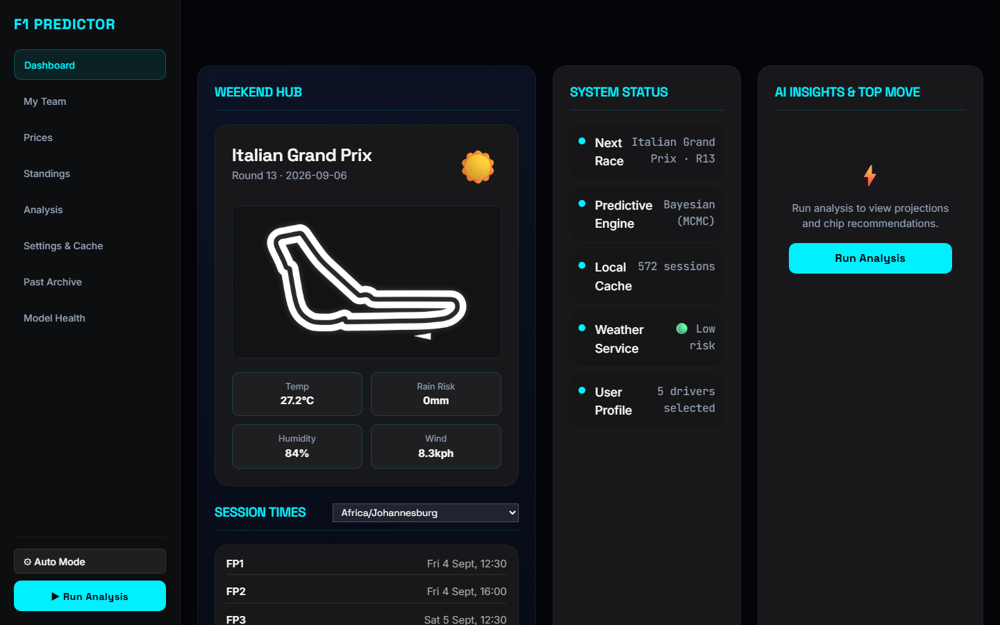
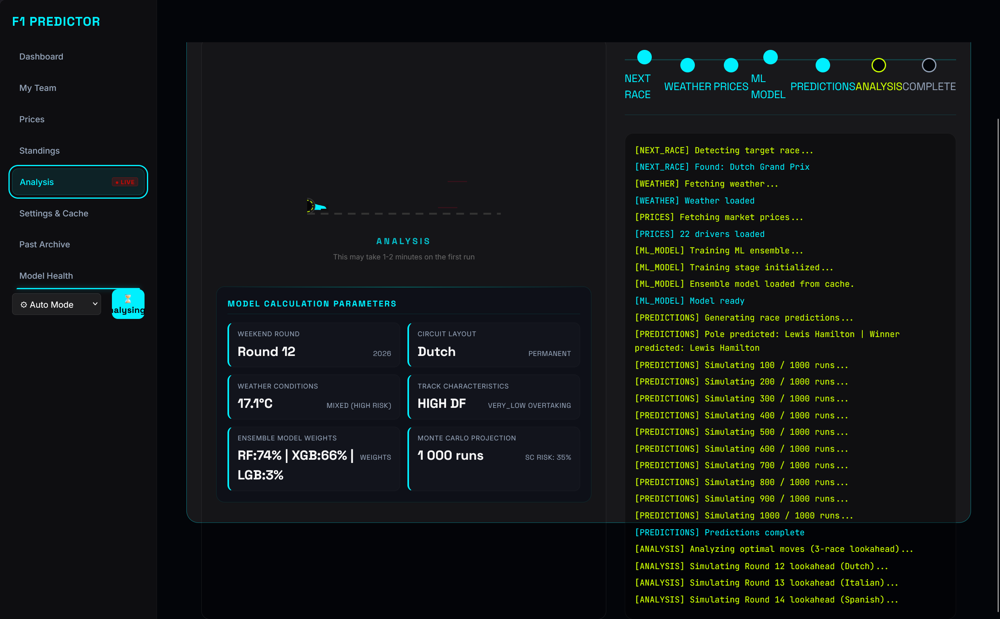
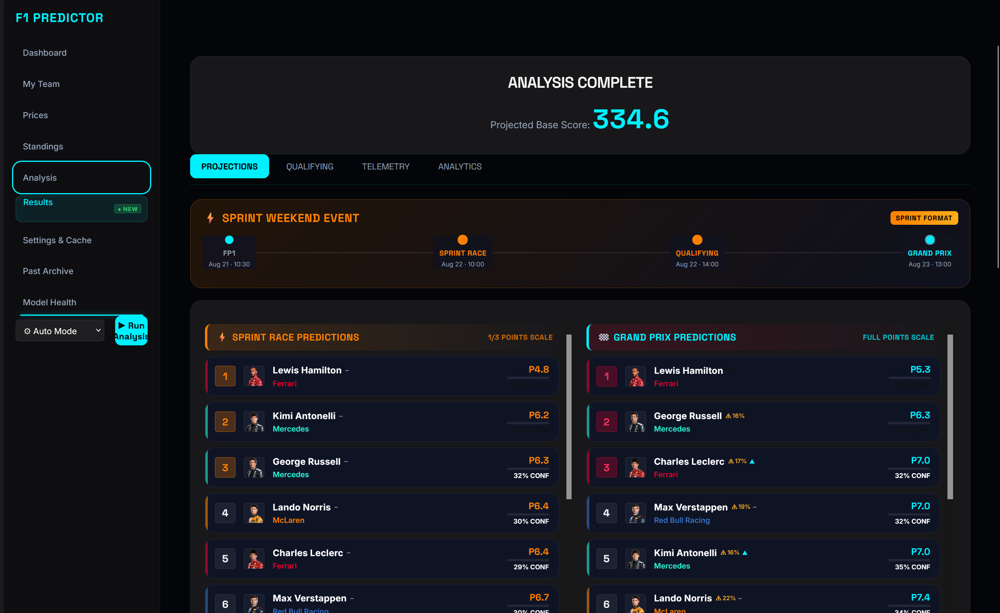
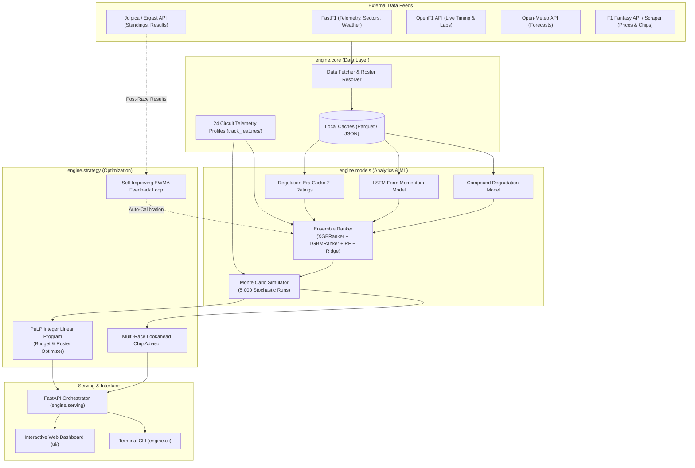
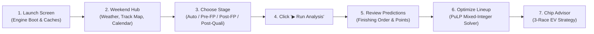

# 🏎️ F1 Fantasy Prediction Engine

[](LICENSE)
[](https://www.python.org/)
[](https://fastapi.tiangolo.com)
[](#-step-7-testing-cache-warming--backtesting)
[-brightgreen.svg)](#-high-performance-calculation-pipeline-153-faster)
[](#-installation--complete-user-guide-zero-to-running)

An advanced, production-grade **Formula 1 Fantasy Prediction & Lineup Optimization Engine**. Powered by an ensemble of machine learning rankers, ground-effect regulation Glicko-2 ratings, LSTM momentum tracking, 56-dimensional ML telemetry features across 24 championship circuits, 5,000-run Monte Carlo stochastic simulations, and integer linear programming lineup optimization.

---

## 📸 Visual Showcase

<div align="center">
  <h3>Desktop Dashboard & Strategy Suite</h3>
  
</div>

<br/>

<div align="center">
  <table>
    <tr>
      <td width="50%">
        <h4 align="center">Race Predictions & Projected Delta</h4>
        
      </td>
      <td width="50%">
        <h4 align="center">Linear Programming Team Optimization</h4>
        
      </td>
    </tr>
  </table>
  <p><em>Responsive interface available across desktop, tablet (<a href="Screenshots/tablet.png">tablet.png</a>), and mobile (<a href="Screenshots/mobile.png">mobile.png</a>).</em></p>
</div>

---

## ⚡ High-Performance Calculation Pipeline (~15.3× Faster)

The calculation and optimization engine has been systematically re-architected for maximum throughput, reducing end-to-end execution time from **234.8 seconds down to 15.3 seconds** (over **93% execution time eliminated**):

- **In-Memory Cache Layer (`_MEM_CACHE`)**: Multi-tiered in-memory dictionary caching with deep-copy protections on top of disk-based JSON caches, eliminating redundant disk I/O and JSON deserialization loops across pipeline runs.
- **FastF1 Negative Caching & Stage Isolation**: Permanent zero-expiry caching for historical seasons and a 1-hour negative cache sentinel for unpopulated/future sessions (such as FP2 on Sprint weekends), eliminating repeated 3-second FastF1 rate-limit backoffs.
- **Direct Tensor Graph Evaluation**: Replaced single-sample `.predict()` invocations with direct callable evaluation (`self.model([seq_n, ctx_n], training=False).numpy()`) and batched whole-roster momentum inference in a single forward pass.
- **Single-Pass MILP Formulation**: Collapsed the 22-iteration CBC solver loop in the fantasy team optimizer into a single unified mixed-integer linear program with turbo candidate selection constraints ($t_i \le d_i, \sum t_i = 1$).
- **Optimized 3-Race Lookahead EV**: Reuses the active round's stochastic Monte Carlo results for round offset 0, cutting repetitive simulation passes while snapshotting and cleanly isolating predictor context across future lookahead rounds.
- **Multi-Core Tree Rankers**: Native parallelization (`n_jobs=-1`) across `LGBMRanker` and `RandomForestRegressor` instances.

---

## 🤖 The Story: 100% AI-Crafted, Vibe Coded & Rigorously Tested

> *"What happens when an engineering student pairs up with frontier AI models to tackle a complex motorsport optimization puzzle?"*

### 🎓 An Engineering Student's Weekend Passion Project
I am primarily an **engineering student**. Outside of university lectures, labs, and coursework, Formula 1 fantasy analytics became a hobby I picked up to explore the intersection of motorsport physics, data science, and mathematical optimization. 

### ⚡ Built Entirely With AI ("Vibe Coded")
This entire project was conceived, architected, implemented, and refactored **100% through human-AI co-piloting and "vibe coding"**. Rather than writing every routine by hand or sticking to trivial scripts, I wanted to explore the outer boundaries of what modern foundation models can achieve when guided by an inquisitive engineer:

- **Google Gemini**: Spearheaded large-scale codebase synthesis, complex multi-file architectural reorganizations, and holistic pipeline orchestration.
- **Anthropic Claude**: Guided nuanced mathematical formulation — including regulation-era Glicko-2 dynamics, LambdaMART pairwise ranking, integer linear programming via PuLP, and EWMA self-improvement loops.
- **Zhipu GLM**: Contributed to rapid algorithmic iteration, telemetry feature exploration, and modular utility scripts.

### 🛡️ "Vibe Coding" With Zero Compromise on Quality
"Vibe coding" often carries a stereotype of producing fragile, unverified scripts. For this project, **being AI-assisted did not mean cutting corners or compromising on quality** — in fact, it demanded even stricter engineering discipline:

- **Collaborative Human-AI Testing**: Every architectural layer went through intense adversarial review and verification loops. If an AI model proposed a change, it had to prove itself with reproducible evidence, rigorous math, and robust error handling.
- **Automated Contract Suite (81/81 Green)**: We engineered and maintained regression tests covering data-ingestion bounds, driver identity drift, fantasy points contracts, and UI asset serving.
- **Multi-Season Backtesting**: Every ranking ensemble was benchmarked against historical races (2022–2025) using time-series cross-validation to guarantee zero future data leakage.

This repository is living proof of the modern paradigm of software engineering: a solo engineering student directing frontier AI models to build a production-grade, highly specialized predictive system without sacrificing an ounce of code quality or scientific rigor.

---

### 1. 🏎️ 24 Championship Circuits & 56 ML Telemetry Features
Every championship circuit (all 24 circuits on the calendar) is modeled using canonical telemetry profiles defined in [`track_features/`](track_features/). The ML ensemble uses a 56-feature vector combining driver form, weather, and circuit physics:
- **Tire & Chassis Demands**: Lateral grip energy, longitudinal traction stress, asphalt micro/macro-abrasion, and degradation multipliers by compound (C1–C6).
- **Aero & Drag Dynamics**: Low, medium, high downforce setups, drag sensitivity, DRS delta impact, and telemetry speed trap benchmarks.
- **Circuit Environment & Chaos**: Safety Car / Virtual Safety Car baseline probabilities, pit lane transit time loss, elevation gradients, and overtaking difficulty indices.

### 2. 🤖 Machine Learning Ranking Ensemble
Replaces generic regressors with pairwise learning-to-rank algorithms tailored for motorsport grids:
- **`XGBRanker` & `LGBMRanker`**: Optimize LambdaMART objective functions across historical race finishes, grid positions, and practice telemetry deltas.
- **`RandomForestRegressor` + Meta-Estimator Stacking**: Blends tree predictions through a penalized `Ridge` meta-estimator to produce robust, variance-reduced point expectations.
- **Strict Leakage Prevention**: Enforces temporal isolation between historical training partitions and active-season test rounds.

### 3. 📈 Dynamic Ratings & Form Momentum
- **Ground-Effect Era Glicko-2**: Dual-rating system that separates driver skill from constructor car development curves since the 2022 regulation reset, preventing historical inertia from skewing modern predictions.
- **LSTM Form Momentum**: Recurrent neural network tracking recent form acceleration, capturing non-linear driver confidence and mid-season technical upgrade packages.

### 4. 🎲 Monte Carlo Engine & PuLP Budget Optimizer
- **5,000 Stochastic Iterations**: Simulates lap-1 incidents, safety cars, wet-weather transitions, mechanical retirements (DNF rate modeling), and overtaking difficulty per circuit.
- **Integer Linear Programming (PuLP / CBC)**: Computes the mathematically global optimal 5-driver + 2-constructor team within official fantasy budget caps ($100M+).
- **Strategic Chip Planning & 3-Race Lookahead**: Recommends optimal timing for *3X Booster*, *Limitless*, *Wildcard*, *No Negative*, *Extra DRS*, and *Autopilot* chips via dynamic programming transfer forecasts.

### 5. 🔄 Self-Improving Feedback Loop
- **Automated Post-Race Validation**: Pulls finalized FIA / Jolpica classification times post-race to compute error residual metrics (MAE, RMSE, Rank Correlation).
- **EWMA Bias Calibration**: Continuously updates constructor efficiency and driver bias factors to auto-correct drift prior to the next grand prix weekend.

---

## 📐 Architecture Dataflow



---

## 🚀 Installation & Complete User Guide (Zero to Running)

> [!NOTE]
> **No programming experience required!** Whether you are a casual Formula 1 fan who has never opened a terminal, or an experienced developer looking for deep telemetry simulations, follow this step-by-step guide to get the prediction engine and interactive visual dashboard running on your computer.

```
Quick Navigation:
├── 📋 Prerequisites & Python Setup (Windows, macOS, Linux)
├── 📥 Step 1: Download the Project
├── ⚡ Step 2: One-Click Launchers (Zero Command Line Needed)
├── 💻 Step 3: Manual Command-Line Installation (Universal)
├── 🖥️ Step 4: Guided Tour of the Web Interface (How to Use It)
├── ⌨️ Step 5: Terminal CLI Mode (Alternative Interface)
├── 🔑 Step 6: Optional Configuration & Account Sync
├── 🧪 Step 7: Testing, Cache Warming & Backtesting
└── ❓ Step 8: Troubleshooting & Frequently Asked Questions (FAQ)
```

---

### 📋 Prerequisites & Python Setup

Before running the application, make sure **Python** is installed on your computer.

> [!IMPORTANT]
> **Recommended Python Version**: **Python 3.10, 3.11, or 3.12**.  
> *(Python 3.13+ is not recommended yet as TensorFlow and prebuilt binary wheels for scientific computing are still transitioning).*

#### 🪟 Windows Setup (Step-by-Step)
1. **Download Python**:
   - Visit the official [Python Downloads for Windows](https://www.python.org/downloads/windows/).
   - Download the installer for **Python 3.11** or **Python 3.12** (Windows installer 64-bit).
2. **Run Installer with PATH Enabled**:
   - Double-click the downloaded `.exe` file.
   - ⚠️ **CRITICAL STEP**: At the very bottom of the first setup screen, check the box that says:
     `☑ Add python.exe to PATH` (or `Add Python to environment variables`).
   - Click **Install Now**.
   - If prompted at the end of installation, click **Disable path length limit**.
3. **Verify Installation**:
   - Open PowerShell or Command Prompt (`Win + R`, type `powershell`, press Enter).
   - Type `python --version` and press Enter. You should see `Python 3.10.x`, `3.11.x`, or `3.12.x`.

#### 🍎 macOS Setup (Step-by-Step)
1. **Open Terminal**: Press `Cmd + Space`, type `Terminal`, and hit Enter.
2. **Install Python**:
   - If you use [Homebrew](https://brew.sh/):
     ```bash
     brew install python@3.11 git
     ```
   - Alternatively, download and run the macOS 64-bit universal installer directly from [python.org/downloads/macos](https://www.python.org/downloads/macos/).
3. **Verify Installation**:
   ```bash
   python3 --version
   ```

#### 🐧 Linux Setup (Debian / Ubuntu / Mint / Pop!_OS)
1. Open your terminal and install Python, pip, virtual environment tools, and Git:
   ```bash
   sudo apt update
   sudo apt install -y python3 python3-pip python3-venv git
   ```
2. **Verify Installation**:
   ```bash
   python3 --version
   ```

---

### 📥 Step 1: Download the Project

Choose **either** Method A (Git) or Method B (ZIP Download):

#### Method A: Using Git (Recommended)
Open your terminal or PowerShell and run:
```bash
git clone https://github.com/Retr0-908/F1-Prediction-engine.git
cd F1-Prediction-engine
```

#### Method B: Download as ZIP (No Git Required)
1. Go to the GitHub repository page: [https://github.com/Retr0-908/F1-Prediction-engine](https://github.com/Retr0-908/F1-Prediction-engine).
2. Click the green **`<> Code`** button near the top right.
3. Click **`Download ZIP`**.
4. Extract the `.zip` file into a folder on your computer (e.g., `Desktop` or `Documents`).
5. Open the extracted `F1-Prediction-engine-main` folder.

---

### ⚡ Step 2: One-Click Launchers (Zero Command Line Needed)

For the easiest experience, use the built-in launchers:

#### 🪟 Windows One-Click Launch
In the project folder, simply **double-click** the file:
```bat
F1 Fantasy.bat
```
- A black console window will open and automatically verify your Python installation.
- The server will start, initialize the prediction pipeline, and display the local URL.
- Open your browser to: **`http://localhost:5762`**
- *Keep the console window open while using the app. Close it whenever you want to shut down.*

*(Prefer classic terminal output? Double-click `RUN_CLI_Legacy.bat` to launch the interactive terminal menu).*

#### 🍎 / 🐧 macOS & Linux One-Click Launch
1. Open your terminal inside the project folder.
2. Make the launcher executable and run it:
   ```bash
   chmod +x run_app.sh
   ./run_app.sh
   ```
3. Open your browser to: **`http://localhost:5762`**

---

### 💻 Step 3: Manual Command-Line Installation (Universal)

If you prefer using the command line or need to configure a clean isolated environment:

#### 1. Open Terminal in the Project Folder
- **Windows**: Inside the project folder, hold `Shift` and right-click any blank space &rarr; select **Open PowerShell window here** (or **Open in Terminal**).
- **macOS / Linux**: Open Terminal and `cd` into the project directory (e.g. `cd ~/Downloads/F1-Prediction-engine`).

#### 2. Create a Virtual Environment
A virtual environment keeps the project libraries separate from your system Python:
```bash
# Windows
python -m venv venv

# macOS / Linux
python3 -m venv venv
```

#### 3. Activate the Virtual Environment
```bash
# Windows (PowerShell)
.\venv\Scripts\Activate.ps1

# Windows (Command Prompt - CMD)
venv\Scripts\activate.bat

# macOS / Linux (bash/zsh)
source venv/bin/activate
```
*(When activated, your terminal prompt will show `(venv)` at the beginning).*

> [!TIP]
> **Windows PowerShell Execution Policy Error?**  
> If PowerShell says *`running scripts is disabled on this system`*, run this command once in PowerShell:  
> `Set-ExecutionPolicy -Scope Process -ExecutionPolicy Bypass`  
> Then re-run `.\venv\Scripts\Activate.ps1`.

#### 4. Install Dependencies
Ensure `pip` is up to date, then install the required libraries:
```bash
python -m pip install --upgrade pip
pip install -r requirements.txt
```

#### 5. (Optional) Install Headless Browser for Live Market Prices
The engine includes a scraper that can pull live driver and constructor price swings from the official F1 Fantasy market:
```bash
python -m playwright install chromium
```
*(If you skip this step, the app will continue using default prices without error).*

#### 6. Start the Engine Server
```bash
python server.py
# or: python -m engine.serving.server
```

#### 7. Open the Visual Dashboard
Open your favorite web browser (Chrome, Edge, Firefox, Brave, Safari) and navigate to:
```
http://localhost:5762
```

---

### 🖥️ Step 4: Guided Tour of the Web Interface (How to Use It)

Once you navigate to **`http://localhost:5762`**, here is how to use every feature:



#### 1. The Launch Screen
When you first open the app, you will see a high-tech boot sequence that:
- Connects to the local FastAPI backend.
- Downloads / verifies the 2026 Grand Prix calendar.
- Fetches real-time weather forecasts for the upcoming race circuit.
- Scrapes live F1 Fantasy market prices and sentiment.
- Restores any previously saved team selections.

#### 2. Weekend Hub (Dashboard Screen)
- **Circuit Header**: Displays the official Grand Prix name, circuit location, and race weekend dates.
- **Track Map**: Renders circuit geometry, DRS activation zones, and sector layouts.
- **Weather Widget**: Real-time ambient temperature, track temperature, precipitation probability, and wind conditions powered by Open-Meteo.

#### 3. Choosing Your Prediction Stage (Sidebar Dropdown)
Select the stage that matches your current timing in the Grand Prix weekend:
- **`⚡ Auto (Live Detection)` (Default)**: Intelligently detects whether practice or qualifying sessions have finished and automatically uses the most recent telemetry.
- **`1. Pre-Practice (Baseline)`**: Runs before any cars hit the track (Tuesday–Thursday). Relies on historical circuit physics, regulation Glicko-2 ratings, and constructor development trajectory.
- **`2. Post-Practice (FP Telemetry)`**: Ingests actual Free Practice (FP1/FP2/FP3) lap times, sector deltas, high-speed cornering stability, and speed trap benchmarks.
- **`3. Post-Qualifying (Grid Locked)`**: Ingests final qualifying grid positions, Q1/Q2/Q3 sector times, and official FIA grid penalties for maximum accuracy before the fantasy lock deadline.

#### 4. Running Predictions
- Click the glowing blue **`▶ Run Analysis`** button in the left sidebar.
- Watch the live step-by-step progress toast as the engine executes:
  1. Glicko-2 ratings update
  2. LSTM driver form momentum evaluation
  3. 56-feature circuit vector construction
  4. 5,000-run Monte Carlo stochastic race simulations
- When complete, the **Race Predictions** panel will display projected finishing positions, expected fantasy point outputs, and delta changes.

#### 5. Optimizing Your Fantasy Team ("My Team" Screen)
- Click **My Team** in the navigation bar.
- **Budget Cap**: Adjust your bank balance slider (defaults to $100.0M, or enter your exact in-game budget).
- **Lock / Exclude Drivers**: Want to force your favorite driver into the lineup, or exclude someone taking an engine penalty? Toggle the lock/exclude icons.
- **Click "Optimize Lineup"**: The **PuLP Mixed-Integer Linear Programming (MILP)** solver calculates the mathematically provable best combination of **5 Drivers + 2 Constructors** within your budget cap, automatically selecting the optimal **2X Turbo Driver**.

#### 6. Multi-Race Lookahead & Chip Strategy
- View multi-race Expected Value (EV) projections for the next 3 Grand Prix.
- The **Chip Strategy Advisor** recommends exactly when to play key chips:
  - **3X Booster**: Highlights the race where your top driver has the highest probability of winning and setting fastest lap.
  - **Limitless**: Identifies power-dominated circuits where max-priced teams dominate.
  - **Wildcard**: Recommends timing for major team restructuring without transfer penalties.
  - **No Negative & Extra DRS**: Suggested for high-chaos, high-SC wet tracks.

#### 7. Prices & Transfer Market
- Click **Prices** in the sidebar to review driver and constructor sentiment, expected price changes ($0.1M increments), and overvalued/undervalued assets.

#### 8. Shutting Down
To stop the application:
- Simply close your browser tab.
- In the open terminal or batch window, press `Ctrl + C` (or close the console window).

---

### ⌨️ Step 5: Terminal CLI Mode (Alternative Interface)

If you are running on a remote headless server or prefer a terminal interface:

#### Interactive Terminal Mode
```bash
python main.py
```
Provides an interactive menu with arrow-key navigation to pick stages, inspect drivers, and run optimizations.

#### Automated Quick Run (Non-Interactive)
```bash
python main.py --auto
```
Runs a complete end-to-end analysis using the current weekend and outputs the dream team directly to stdout.

#### Custom Budget and Stage Flags
```bash
# Run with a custom $106.2M budget in post-qualifying mode:
python main.py --budget 106.2 --stage post-quali

# Run baseline pre-practice simulation:
python main.py --stage pre-practice
```

---

### 🔑 Step 6: Configuration & Official Account Sync (100% Optional)

#### ⚡ Out-of-the-Box: Zero API Keys Required!
The engine works **100% out of the box with zero API keys or external sign-ups**. All core telemetry, historical results, and circuit forecasts are retrieved from free, public community APIs:
- **FastF1 Telemetry**: Directly accessible with zero authentication.
- **Jolpica / Ergast API**: Open motorsport classification database.
- **OpenF1**: Open-access timing and telemetry stream.
- **Open-Meteo**: Free weather forecasts with no API key or sign-up needed.

You can run full predictions immediately without registering anywhere.

---

#### 🍪 (Optional) Official F1 Fantasy Session Cookie (`F1_FANTASY_COOKIE`)
*Syncs your official team, bank balance, and chip status directly from the official website.*

> [!TIP]
> If you omit this, the app still works completely! You can enter your team and budget into the web interface manually.

If you want one-click syncing:
1. Log in to **[fantasy.formula1.com](https://fantasy.formula1.com/)** in your browser.
2. Press **`F12`** (or right-click &rarr; **Inspect**) to open Developer Tools.
3. Switch to the **Application** tab (in Firefox, choose **Storage**).
4. In the left panel, expand **Cookies** &rarr; select **`https://fantasy.formula1.com`**.
5. Copy the value of the **`login-session`** cookie.
6. Create your local `.env` file from the example:
   ```bash
   # Windows (PowerShell)
   Copy-Item .env.example .env

   # macOS / Linux
   cp .env.example .env
   ```
7. Open `.env` in any text editor and paste your cookie:
   ```env
   F1_FANTASY_COOKIE=login-session="your_cookie_value_here"
   ```
   *(Or set it interactively via terminal: `python main.py --set-cookie`).*

---

#### ☀️ (Optional) OpenWeatherMap API Key (`OPENWEATHERMAP_API_KEY`)
*The engine uses **Open-Meteo** by default (free, no key needed). If you want an extra weather redundancy source:*
1. Sign up at [OpenWeatherMap](https://home.openweathermap.org/users/sign_up).
2. Grab your free 32-character API key from [home.openweathermap.org/api_keys](https://home.openweathermap.org/api_keys).
3. Add it to your `.env` file:
   ```env
   OPENWEATHERMAP_API_KEY=your_api_key_here
   ```

---

### 🧪 Step 7: Testing, Cache Warming & Backtesting

Verify your setup or run historical evaluations:

```bash
# 1. Run all unit and regression contract tests (81 tests)
python -m unittest discover engine/tools/tests

# 2. Warm telemetry caches for instant pipeline execution
python -m engine.tools.verify_caches

# 3. Execute historical multi-season backtest (2022 - 2025 seasons)
# Windows:
BACKTEST.bat
# macOS / Linux:
chmod +x backtest.sh && ./backtest.sh
```

---

### ❓ Step 8: Troubleshooting & Frequently Asked Questions (FAQ)

<details>
<summary><strong>Q1: 'python' is not recognized as an internal or external command (Windows)</strong></summary>

**Cause**: Python was installed without adding it to your system PATH environment variable.  
**Fix**:
1. Re-run the Python installer `.exe`.
2. Select **Modify** or **Reinstall**.
3. Check the box **"Add python.exe to PATH"**.
4. Finish installation and open a **new** PowerShell window.
</details>

<details>
<summary><strong>Q2: PowerShell says "File Activate.ps1 cannot be loaded because running scripts is disabled"</strong></summary>

**Cause**: Windows restricts unsigned script execution by default in PowerShell.  
**Fix**:
Run this command in PowerShell before activating:
```powershell
Set-ExecutionPolicy -Scope Process -ExecutionPolicy Bypass
```
Then run `.\venv\Scripts\Activate.ps1` again.
</details>

<details>
<summary><strong>Q3: "Address already in use" or Port 5762 conflict</strong></summary>

**Cause**: A previous instance of the server is still running in the background.  
**Fix**:
- **Windows**: Open PowerShell and kill any process on port 5762:
  ```powershell
  Stop-Process -Id (Get-NetTCPConnection -LocalPort 5762).OwningProcess -Force
  ```
- **macOS / Linux**:
  ```bash
  kill -9 $(lsof -ti:5762)
  ```
- Alternatively, launch on a different port:
  ```bash
  python -c "import uvicorn; uvicorn.run('engine.serving.server:app', host='127.0.0.1', port=5765)"
  ```
  Then browse to `http://localhost:5765`.
</details>

<details>
<summary><strong>Q4: Why does the very first run take 15–30 seconds?</strong></summary>

**Normal Behavior**: On the initial run, FastF1 downloads and caches official timing and telemetry data into `.cache/fastf1/`. Subsequent runs utilize our in-memory cache layer (`_MEM_CACHE`) and complete in **under 15 seconds**.
</details>

<details>
<summary><strong>Q5: Building wheels / C++ compiler error during `pip install`</strong></summary>

**Cause**: You may be using Python 3.13 or 3.14 where precompiled binary wheels for TensorFlow/SciPy are not yet published.  
**Fix**: Install **Python 3.11** or **Python 3.12** from [python.org/downloads](https://www.python.org/downloads/). Pre-built binary wheels exist for all dependencies on Python 3.10–3.12, requiring zero compilers.
</details>

<details>
<summary><strong>Q6: How do I update to the latest code when a new race weekend arrives?</strong></summary>

If using Git:
```bash
git pull origin main
pip install -r requirements.txt
```
If using ZIP: Download the latest ZIP, copy your `.env` file over if you had one, and run `F1 Fantasy.bat`.
</details>

<details>
<summary><strong>Q7: How do I completely reset caches if data feels outdated?</strong></summary>

Inside the Web Dashboard, navigate to **Settings & Cache** in the sidebar, and click **Rebuild All Caches**. Alternatively, delete the `.cache/` folder in the project root; the engine will re-download clean data on next launch.
</details>

---

## 📂 Project Structure

```
F1-Prediction-engine/
├── engine/                       # Core python engine package
│   ├── core/                     # API fetchers, config, filesystem paths, weather
│   ├── models/                   # ML rankers, Glicko-2, LSTM, tire, Monte Carlo
│   ├── strategy/                 # PuLP lineup optimizer, chip advisor, feedback loop
│   ├── analysis/                 # Historical backtester, race reporter, validators
│   ├── serving/                  # FastAPI web server and pipeline orchestrator
│   ├── cli/                      # Command-line interface application
│   └── tools/                    # Automated testing suites and cache utilities
├── ui/                           # Single-page web dashboard (HTML5, CSS3, JS)
├── track_features/               # Canonical telemetry profiles for all 24 Grand Prix circuits
├── Docs/                         # Engineering documentation & architecture plans
│   ├── MAINTENANCE.md            # Season handover, track updates & maintenance guide
│   ├── CONTRIBUTING.md           # Developer guidelines & contribution standards
│   └── REORGANIZATION_PLAN.md    # Architectural foundation documentation
├── Screenshots/                  # High-resolution application screenshots
├── F1 Fantasy.bat                # Windows native web launcher
├── run_app.sh                    # Unix native web launcher
├── requirements.txt              # Production Python package dependencies
└── LICENSE                       # GNU General Public License v3.0
```

---

## 📖 Documentation & Maintenance

- **Maintenance Guide**: Refer to [`Docs/MAINTENANCE.md`](Docs/MAINTENANCE.md) for annual driver market changes, calendar updates, adding new circuit telemetry files, and updating dependencies.
- **Contribution Standards**: Review [`CONTRIBUTING.md`](CONTRIBUTING.md) for pull request workflows, code style, and test coverage requirements.

---

## ⚖️ Legal Disclaimer & Fair Use Notice

This project is an **unofficial, non-commercial, open-source community tool** developed strictly for personal, educational, and analytical research purposes. 

- It is **not** associated, affiliated, authorized, endorsed by, or in any way officially connected with **Formula 1**, **Formula One Licensing B.V.**, **Formula One Management Ltd**, the **FIA (Fédération Internationale de l'Automobile)**, or **F1 Fantasy**.
- All official Formula 1 marks, team names, driver names, circuit names, logos, and related intellectual property are registered trademarks of Formula One Licensing B.V. or their respective owners.
- Driver headshot cutouts and constructor insignias displayed in the UI are low-resolution assets utilized strictly for nominative identification under **Fair Use** principles. No copyright infringement is intended.
- **Notice & Takedown**: If you are a copyright or trademark holder and request the removal or replacement of any specific media asset, please open a GitHub issue or contact the repository maintainer, and the asset will be promptly removed.

---

## 🙏 Acknowledgements & Data Sources

This open-source project is made possible through the generous data and tooling provided by the motorsport engineering and open-source community:

- **[FastF1](https://github.com/theOehrly/Fast-F1)**: Exceptional Python library for Formula 1 telemetry, session timing, and sector analysis.
- **[Jolpica-F1 / Ergast](https://github.com/jolpica/jolpica-f1)**: Community-maintained REST API preserving historical championship classifications and standings.
- **[OpenF1](https://openf1.org/)**: Real-time open telemetry and timing data feeds.
- **[Open-Meteo](https://open-meteo.com/)**: High-precision meteorological forecast APIs.
- **[PuLP & COIN-OR CBC](https://github.com/coin-or/pulp)**: Linear programming optimization engine.

---

## 📄 License

This project is licensed under the **GNU General Public License v3.0 (GPLv3)**.  
See the [`LICENSE`](LICENSE) file for the full license terms.

```
Copyright (C) 2024-2026 Retr0-908 & Contributors

This program is free software: you can redistribute it and/or modify
it under the terms of the GNU General Public License as published by
the Free Software Foundation, either version 3 of the License, or
(at your option) any later version.
```
